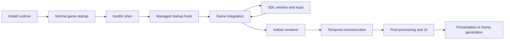

# VulkanStory documentation

VulkanStory replaces Vintage Story's window, input and graphics backend while
running in the official game process. These pages describe the implementation in
the `rewrite` branch. A release ZIP may predate changes documented here; the
[roadmap](ROADMAP.md) identifies the current release and known defects.

## For players

| Guide | What it covers |
| --- | --- |
| [Player guide](player-guide.md) | Installation, settings, commands, troubleshooting and removal |
| [Settings reference](settings-reference.md) | Every renderer setting, defaults, ranges and when changes apply |
| [Window and controllers](window-and-input.md) | SDL events, mapping, controller profiles, menus and analog movement |
| [Performance](performance.md) | What each optimization changes and how to read a capture |

## How it works

| Guide | What it covers |
| --- | --- |
| [Architecture](architecture.md) | Components, startup routing, ownership and compatibility |
| [Bootstrap and installation](bootstrap-and-installation.md) | Host shim, startup hook, ZIP layout, installer and removal |
| [Rendering](rendering.md) | Frame order, shaders, Vulkan resources, TAA, GTAO, providers and presentation |
| [Mod integration](mod-integration.md) | Game RenderAPI, declared passes, attachments and motion writers |
| [Development](development.md) | Source builds, packages, source navigation and diagnostics |
| [Headless harness](headless-harness.md) | Isolated world captures and scripted runtime scenarios |

The diagrams explain code flow and ownership. They are not measured performance
graphs. Frame generation, for example, adds presentation images without adding
game simulation ticks. Performance results depend on the scene, settings and
hardware; use a capture rather than treating a diagram as a benchmark.

Ray/path tracing, OpenXR VR and user-selectable shader packs remain roadmap work.
They are not part of the renderer described here.
