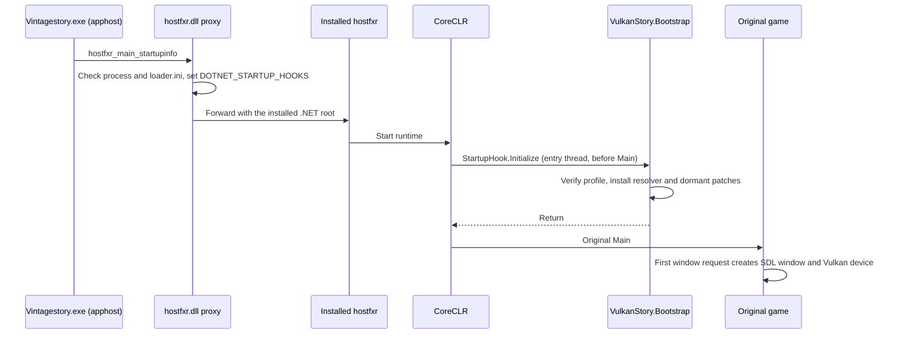
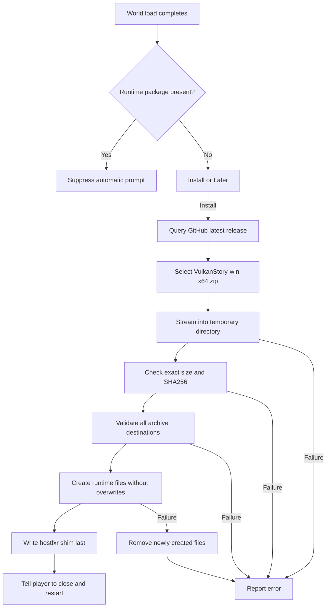

# Bootstrap and installation

VulkanStory is a drop-in for an existing official Vintage Story installation. It
has to own the first game window, so it activates before the game's `Main` runs.
A ZIP placed only in `Mods` cannot do that. Player-facing steps are in the packaged
[client README](../packaging/README-client.txt) and
[Linux README](../packaging/README-linux-client.txt).

The [v0.1.5 release](https://github.com/KillerPixelCrew/VulkanStory/releases/tag/v0.1.5)
ships the Windows x64 client, installer mod and optional dedicated-server input companion, plus
`SHA256SUMS.txt` and `archives.json`. Linux activation below describes the source
tooling; no Linux client archive is published in this release.

## Windows activation

`Vintagestory.exe` is a framework-dependent .NET apphost. Before using the
installed .NET host, the apphost looks for an app-local `hostfxr.dll` in its own
directory. VulkanStory ships its proxy under that name (`native/bootstrap`). It
does not use `version.dll`, so it does not collide with proxies that do, such as an
MFG enabler.



### Native proxy

- `DllMain` only records the module handle and a timestamp. Host discovery, file
  checks, logging and environment changes happen in the forwarded export, outside
  the loader lock.
- Exports `hostfxr_main_startupinfo`, `hostfxr_main`,
  `hostfxr_main_bundle_startupinfo` and `hostfxr_set_error_writer`. Only
  `hostfxr_main_startupinfo` can arm the startup hook. The others forward unchanged.
- Finds the real host from `DotnetRoot` in `loader.ini`, then `DOTNET_ROOT_X64`,
  `DOTNET_ROOT`, the registered x64 install location, then `Program Files\dotnet`.
  It loads the newest `host/fxr/<version>/hostfxr.dll` and refuses to load itself
  recursively. The installed root is passed on as the .NET root, so frameworks are
  never resolved from the game directory.
- Arms the hook only when all of these hold: the host is `Vintagestory.exe`, the
  app is `Vintagestory.dll`, `[Bootstrap] Enabled` is not `0`, and
  `VulkanStory/managed/` contains `VulkanStory.Bootstrap.dll`,
  `VulkanStory.Game.dll` and `profiles/vs-1.22.7-win-x64.json`. The server, crash
  reporter and other tools only get forwarding.
- Prepends the hook path to any existing `DOTNET_STARTUP_HOOKS` and sets
  `VULKANSTORY_BOOTSTRAP_LOG`. Both are restored after the host call returns,
  unless something else has changed them in the meantime.
- If setting up the hook fails, only the hook is skipped and the game starts
  normally. If forwarding fails, the proxy returns a host error and tells the user
  to remove `hostfxr.dll`.
- Events are written to `%LOCALAPPDATA%\VulkanStory\Logs\bootstrap-<pid>-<qpc>.jsonl`.

### Automatic crash reports

Before the real host starts .NET, the enabled Windows proxy starts the bundled
`VulkanStory.CrashMonitor.exe`, outside the loader lock. It attaches only to this
game process and waits for the initial attachment event before managed startup.
An existing debugger is left alone; attachment failures are recorded in the
bootstrap log and do not prevent the game from starting. Closing the helper
detaches it without terminating the game.

The managed bootstrap records unhandled exceptions on any managed thread; an
observer finalizer also records exceptions escaping the game's main entry without
suppressing them. Native second-chance exceptions, including Windows fast-fail
`0xC0000409` and stack overflow, are captured by the separate helper because they
can bypass all in-process exception handlers.

Reports appear under `%LOCALAPPDATA%\VulkanStory\Crashes`. After a crash, a ZIP
contains the exception parameters, native thread stacks, a stack minidump, loaded
module/driver versions, managed exception text, matching bootstrap/game logs,
settings and mod filenames. The helper uses local symbols without downloading
anything. Settings account fields are removed and the minidump excludes the game
heap and filters stack data; logs can still contain private information, so review
the archive before sharing. No debugger installation, administrator rights or
registry changes are required. `[Bootstrap] CrashCapture=0` disables the native
helper. The native helper and ZIP collector are Windows-only.

### AMD continuation compatibility

The official 1.22.7 Windows executable is CET-compatible. Some AMD Vulkan driver
context restores are rejected by Windows with `FAST_FAIL_SET_CONTEXT_DENIED`
(`0xC0000409`, subcode `0x30`). For an AMD primary display and active, strict
continuation validation, the enabled loader starts the same original executable
once with Windows' relaxed continuation-validation policy, before managed startup.
It forwards the original command line and working directory and propagates the
game's exit code. The child verifies the applied policy and removes its restart
marker before any game child processes are created.

Relaxed validation permits dynamic-code and legacy-library continuation targets;
it still validates targets in binaries with exception-continuation metadata.
Hardware shadow-stack protection remains enabled. This compatibility mode is
limited to the game process: it does not edit the executable, registry or global
Windows settings. Set `[Bootstrap] AmdContextCompatibility=0` to retain the original
strict continuation policy. `1` selects AMD primary displays automatically; `2`
explicitly requests compatibility, including systems rendering on a secondary AMD
GPU. Non-AMD primary displays in automatic mode and processes already using relaxed
validation are forwarded directly. Other processes and disabled/incomplete
bootstrap payloads never restart.

### Managed bootstrap

`StartupHook.Initialize` runs once, on the entry thread, before `Main`:

1. Removes its own entry from `DOTNET_STARTUP_HOOKS`, so child processes do not
   inherit it.
2. Requires an x64 Windows or Linux process whose entry assembly is `Vintagestory`
   (or `dotnet` with `VULKANSTORY_HEADLESS=1` for the
   [headless harness](headless-harness.md)).
3. Reads `VulkanStory/loader.ini`. `Enabled=0` bypasses activation. A missing file
   means enabled on Windows and bypass on Linux.
4. Loads `managed/profiles/vs-1.22.7-<rid>.json`, requires .NET 10, and checks the
   SHA256 of the official game files listed there (executable, game assemblies,
   runtimeconfig/deps, `Lib/0Harmony.dll`, …).
5. Registers an `AssemblyLoadContext.Default.Resolving` handler. VulkanStory
   assemblies and their private dependencies (SDL3-CS, Silk.NET, DependencyModel)
   resolve from `VulkanStory/managed`. Game assemblies and Harmony resolve from the
   game directory and its `Lib` folder. Identities are checked; there is no
   mod-directory probing and no second load context.
6. Requires `VulkanStory.Game.dll` to have the same assembly version as the
   bootstrap, loads it into the default context and calls
   `RuntimeBootstrap.Install`. That prepares the dormant startup patch transaction
   described in [architecture](architecture.md#startup-routing).

Any failure unregisters the resolver, publishes `VulkanStory.Bootstrap.Status =
bypassed`, and lets the unmodified game start with OpenGL. A game update that
changes a profiled file therefore results in vanilla startup, not a partially
patched one. The ordinary mod reports the inactive state in the client log.

## Linux activation

Linux has no apphost proxy. `install-linux-runtime.sh` makes a one-time change to
the official `run.sh`, which the normal desktop entry launches. It inserts one
tagged block (`# BEGIN/END VULKANSTORY STARTUP HOOK v1`) before the unchanged
`./Vintagestory "$@"` line. The installer requires `run.sh` to match the profile
hash and to contain exactly one such invocation.

The block reads `[Bootstrap] Enabled` from `VulkanStory/loader.ini` (size-limited)
and, if enabled, appends `VulkanStory/managed/VulkanStory.Bootstrap.dll` to
`DOTNET_STARTUP_HOOKS`. Existing hooks are kept. From there the managed bootstrap
is the same as on Windows. Launch paths that start the `Vintagestory` binary
directly without `run.sh` are not activated.

The Linux native set is `libSDL3.so`, `libshaderc_shared.so` and the required
`libVulkanStoryVma.so`, plus an optional
`libVulkanStoryNgx.so` for DLSS (`packaging/native-linux-x64.json`). The
Streamline, FSR 4 and XeSS-FG bridges are Windows-only and are not included.

## `loader.ini`

```ini
[Bootstrap]
Enabled=1     ; 0 skips VulkanStory at the next launch
CrashCapture=1 ; Windows only: automatic native crash reports
AmdContextCompatibility=1 ; Windows only: relaxed continuation validation on AMD primary displays
DotnetRoot=   ; Windows only: optional absolute .NET root for the proxy
```

## Package layout

Installed layout. On Windows the client archive is extracted directly into the game
directory; on Linux the installer copies it there:

```text
<game directory>/
  hostfxr.dll                      # Windows activation proxy
  VulkanStory/
    loader.ini
    README.txt
    package.json                   # Product identity and SHA256 inventory
    native-inventory.json
    install.json                   # Written by the installer: ownership receipt
    managed/
      VulkanStory.{Bootstrap,Contracts,Game,Input,Platform.Sdl,Render.Vulkan}.dll
      ReScaleFrame.{Contracts,Vulkan}.dll
      SDL3-CS.dll, Silk.NET.*.dll, Microsoft.*.dll
      profiles/vs-1.22.7-<rid>.json
    native/<rid>/                  # SDL3, shaderc, VMA, provider bridges, vendor runtimes
      VulkanStory.CrashMonitor.exe # Windows-only native crash capture
      VulkanStory.CrashReport.ps1  # Automatic report ZIP collection
    shaders-vk.pak                 # Native SPIR-V and shaders.manifest.json in one file
    assets/gamecontrollerdb.txt
    tools/                         # deployment/removal helpers
      performance/                 # external .NET performance collector, report template and notices
    licenses/
  Mods/
    vulkanstory/                   # VulkanStory.Mod.dll, modinfo.json
    vulkanstoryinput/              # Input companion for the integrated server
```

`VulkanStory.Input.dll` exists in both `managed/` and `Mods/vulkanstoryinput/`.
Both copies come from the same build, so they have the same assembly identity.
Native and vendor DLLs are kept out of `Mods`, so the game's mod scanner never sees
them. A separate `VulkanStory-Input-Companion.zip` contains only
`vulkanstoryinput/`, for a dedicated server's `Mods` directory.
The performance collector and its private Microsoft diagnostics dependencies live
under `tools/performance`, outside the game's mod-scanner directories. In-game
`.vulkanstory profile start [seconds]`, `stop` and `status` use this packaged tool.

Windows `native/win-x64` (from `packaging/native-win-x64.json`):

| Component | Files |
| --- | --- |
| Core | `SDL3.dll`, `shaderc_shared.dll`, `VulkanStoryVma.dll`, `openxr_loader.dll` |
| Presentation | `VulkanStoryAuxPresent.dll`, `VulkanStoryWsi.dll`, `VulkanStoryWsi.json` |
| DLSS | `VulkanStoryNgx.dll`, `nvngx_dlss.dll` |
| FSR 3 | `VulkanStoryFsr3.dll`, `amd_fidelityfx_vk.dll` |
| FSR 4 | `VulkanStoryFsr4.dll`, `amd_fidelityfx_upscaler_dx12.dll` |
| XeSS | `libxess.dll` |
| XeSS-FG / XeLL | `VulkanStoryXessFg.dll`, `libxess_fg.dll`, `libxell.dll` |
| Streamline (DLSS-G, Reflex, PCL) | `VulkanStoryStreamline.dll`, `sl.interposer.dll`, `sl.common.dll`, `sl.reflex.dll`, `sl.pcl.dll`, `sl.dlss_g.dll`, `nvngx_dlssg.dll`, `NvLowLatencyVk.dll` |

## Building a package

Packaging uses fresh output directories; build scripts can reuse verified outputs.
Each script documents its parameters (`Get-Help scripts/<name>.ps1 -Full`) and
never launches the game. Native provider bridges and SDK corrections come from the pinned
ReScaleFrame submodule at `sdk/rescaleframe`. Vendor SDKs are
pinned submodules under `sdk/` (`dlss`, `fidelityfx-vk`, `fidelityfx`, `xess`,
`streamline`, `vma`, `openxr`) and are the scripts' default SDK roots. The VMA bridge is
mandatory and its MIT notice ships in `licenses/native/vma/LICENSE.txt`.
The Windows FSR 3 runtime is rebuilt from the pinned SDK with the tracked
[luma-history format correction](../sdk/rescaleframe/runtime/vulkan/fsr3/sdk-fixes/README.md).
Bundling requires its matching source/correction and binary hash receipt.
The Streamline common/interposer components are also rebuilt from the pinned SDK
with the renderer's Vulkan dispatch corrections; their source and binary receipts
ship with the native notices. Other Streamline redistributables retain their
release hashes.

| Step | Script | Result |
| --- | --- | --- |
| 1 | `fetch-streamline-release.ps1` | Hash-checked Streamline 2.14.1 release ZIP extracted to the git-ignored `sdk/streamline-release-2.14.1`. Supplies the redistributables and reference hashes; corrected common/interposer builds are produced from the pinned source SDK |
| 2 | `build-runtime.ps1` | Managed projects, required VMA bridge in `artifacts/native-vma/<Configuration>/<rid>`, corrected Windows FidelityFX Vulkan runtime in `artifacts/rescaleframe/fsr3-sdk/Release/win-x64/runtime`, Windows proxy (CMake), and shader corpus/pack in `artifacts/runtime-shaders/<Configuration>`. Requires `g++` and Vulkan headers; the Windows SDK build also needs MSVC x64 tools and the Vulkan import library. Matching corrected SDK builds are reused. `-RuntimeIdentifier linux-x64` builds on Linux |
| 3 | `build-provider-bridges.ps1` | Windows provider, auxiliary-presentation, WSI and VMA bridges (needs `g++`/`gcc` and `VULKAN_SDK`) |
| 4 | `prepare-native-bundle.ps1` | Bridges, core binaries, vendor runtimes and notices from `native-win-x64.json`. `-VmaDirectory` accepts the runtime build's allocator bridge. Corrected runtimes require matching source/build receipts; other Streamline runtimes must match release hashes |
| 5 | `stage-runtime.ps1` | The layout above plus `optional-server/`. Checks the `-ShaderPack` index, blob hashes and manifest coverage, and writes the SHA256 inventory `package.json` |
| 6 | `package-runtime.ps1` | Verifies the staged hashes and writes `VulkanStory-<rid>.zip`, `VulkanStory-Input-Companion.zip` and `archives.json` |

## Install, update, disable, remove

Close the game, server and crash reporter first.

| Operation | Windows | Linux |
| --- | --- | --- |
| Clean install | Extract the client ZIP into the game directory | Extract to a package directory, then `bash VulkanStory/tools/install-linux-runtime.sh <package> <game> <fresh-backup>` |
| Update | `VulkanStory/tools/deploy-runtime.ps1 -GameDirectory … -PackageDirectory … -BackupDirectory …` | Re-run the installer with the new package |
| Disable | Disable in the mod manager and restart, or set `Enabled=0` in `loader.ini` | Same |
| Remove | `VulkanStory/tools/remove-runtime.ps1 -GameDirectory … -BackupDirectory …` (supports `-WhatIf`) | `bash VulkanStory/tools/remove-linux-runtime.sh <game> <fresh-backup>` |

The installer/updater (`deploy-runtime.ps1`, `install-linux-runtime.sh`):

- checks the game against the package profile and the package against `package.json`
- refuses to overwrite files it does not own or that were modified, and does not
  follow symlinks or reparse points
- backs up overwritten files to a fresh directory outside the game and package
- writes dependencies first and the activation (`hostfxr.dll` or the `run.sh`
  block) last, and restores the previous state on failure
- keeps an existing `loader.ini` and deletes nothing. Files dropped from a newer
  package stay recorded as owned. Installed hashes go to `VulkanStory/install.json`
- on Windows, checks that an existing `version.dll` is unchanged

Removal removes the activation first. It then moves unchanged owned files to the
backup and leaves modified files, saves, settings, `version.dll` and empty
directories in place. On Linux it verifies the tagged block before restoring the
original `run.sh`.

Disabling in the mod manager takes effect at the next launch's first window
request: routing is removed and the game uses OpenGL. `Enabled=0` skips the
managed bootstrap entirely.

## Installer mod

The separate `vulkanstoryinstaller` mod is an ordinary client code mod. Its ZIP
contains `modinfo.json` and `VulkanStory.Installer.Mod.dll` at the archive root.
It is placed in a Mods directory, unlike the full runtime ZIP which extracts
into the game directory. The mod does not load renderer libraries or initialize
the shim in the already-running process.

`InstallerModSystem` subscribes to `LevelFinalize`. Once the first world finishes
loading, it opens the installation dialog if that mod instance has not prompted
and `VulkanStory/package.json` is absent. `.vulkanstoryinstall` opens the dialog
manually. World leave disposes it and cancels outstanding work.



`RuntimeDownload` uses GitHub's `/repos/KillerPixelCrew/VulkanStory/releases/latest`
endpoint. It chooses the exact Windows client asset name, uses the published asset
size, and requires the asset's `sha256:` digest. There is no installed-version
comparison, downgrade selection or separate updater in this mod. GitHub latest
release behavior determines the selected release.

The Windows x64 check happens before download. Requests have a 30-minute timeout.
Download progress reports transferred/total MiB. The verified ZIP is opened and
all file destinations are checked before copying. Only `hostfxr.dll`,
`VulkanStory/`, `Mods/vulkanstory/`, and `Mods/vulkanstoryinput/` are accepted.
Parent/dot components, drive-qualified paths, duplicate destinations, paths outside
the game root, and linked destination ancestors within the checked tree are
rejected. Existing files or directories at a file destination are refused.

Extraction uses `FileMode.CreateNew`, and records created files for cleanup on
failure. Runtime files precede the activation shim so incomplete extraction does
not install a shim pointing at missing dependencies. Temporary download cleanup
is attempted regardless of outcome. Empty created directories can remain after
failure. Cancellation is checked between extraction entries; copying one entry
does not stop midway through that synchronous copy.

On success, the mod tells the player to close and restart the game. The existing
process remains on its current renderer. The next normal launch uses the shim
and bootstrap sequence documented above. Removing the installer ZIP afterwards
does not remove the installed runtime.

This installer differs from `deploy-runtime.ps1`: it does not validate each
official game file against the package profile before extraction, produce an
`install.json` receipt, preserve/replace existing payload, or perform an update.
The normal early bootstrap still verifies the game profile at the next launch.
Fresh ZIP installs use `package.json` for removal inventory when no ownership
receipt exists. Close the game before using the update/removal scripts.

Player steps are in [player guide](player-guide.md); separate installer packaging
is in [development](development.md#build-the-small-installer-mod).

## References

- [.NET startup hooks](https://github.com/dotnet/runtime/blob/main/docs/design/features/host-startup-hook.md)
- [.NET host components](https://github.com/dotnet/runtime/blob/main/docs/design/features/host-components.md)
- [`DllMain` loader-lock rules](https://learn.microsoft.com/en-us/windows/win32/dlls/dllmain)
- [.NET default probing](https://learn.microsoft.com/en-us/dotnet/core/dependency-loading/default-probing)
