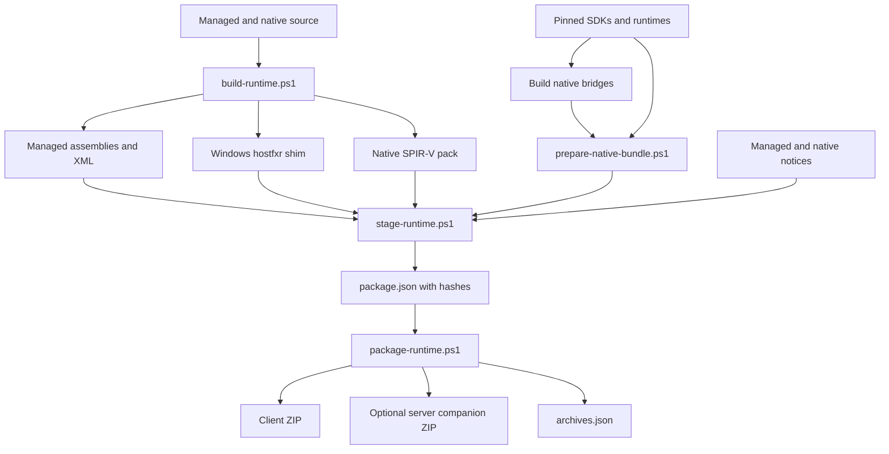

# Development and packaging

## Repository and dependencies

Active development is on `rewrite`. The source is organized around an early
bootstrap, game adapter, game-independent renderer/SDL libraries, and ordinary
mod entry points. See [architecture](architecture.md) for ownership boundaries.

Build against the official Vintage Story 1.22.7 installation. Game assemblies
are references with `Private=false` and are not packaged. Set `VintageStoryPath`
in `Directory.Build.local.props`, using the example file as the template.

| Tool/input | Used for |
| --- | --- |
| .NET 10 SDK matching `global.json` | Managed projects and tooling |
| Official game installation | API, client internals, Harmony and supporting references |
| CMake/Ninja | Native Windows activation shim |
| Vulkan SDK | Headers and native Vulkan imports |
| MinGW-w64 GCC/G++ | Native provider and allocation bridges |
| MSVC x64 build tools | Corrected FidelityFX Vulkan runtime and OpenXR loader |
| `sdk/` submodules | Pinned vendor source SDKs and VMA |
| Streamline release download | Hash-pinned redistributable runtimes |

```powershell
git submodule update --init
pwsh scripts/fetch-streamline-release.ps1
```

The Streamline fetch script supplies the release redistributables; SDK source
alone is not a replacement for those binaries. Native notices travel with the
bundle. Dependencies are selected from the pinned inputs rather than whatever
same-named DLL happens to exist elsewhere on the machine.

## Build and package flow



`build-runtime.ps1` builds production managed projects, the allocator bridge,
Windows bootstrap, corrected FidelityFX runtime, pinned Khronos OpenXR loader,
and the shader tool/corpus.
Provider bridges are built separately. Staging consumes existing outputs; it does
not secretly build missing components. Packaging verifies staged hashes and writes
archives without installing or launching the game.

```powershell
pwsh scripts/build-runtime.ps1 -Configuration Release
pwsh scripts/build-provider-bridges.ps1 -OutputDirectory <fresh-bridges-directory>
```

Use the parameter help for explicit native input paths:

```powershell
Get-Help scripts/prepare-native-bundle.ps1 -Full
Get-Help scripts/stage-runtime.ps1 -Full
Get-Help scripts/package-runtime.ps1 -Full
```

The staging call requires native binaries, native notices, managed notices, shader
pack and fresh output directory:

```powershell
pwsh scripts/stage-runtime.ps1 `
  -Configuration Release `
  -RuntimeIdentifier win-x64 `
  -NativeDirectory <native-bundle> `
  -NativeLicensesDirectory <native-notices> `
  -ManagedLicensesDirectory <managed-notices> `
  -ShaderPack artifacts/runtime-shaders/Release/shaders-vk.pak `
  -OutputDirectory <fresh-stage>

pwsh scripts/package-runtime.ps1 `
  -StagingDirectory <fresh-stage> `
  -OutputDirectory <fresh-archives>
```

Angle-bracket paths are placeholders. Choose actual directories; fresh means the
destination does not already exist. `package.json` records file hashes and profile;
`archives.json` records archive hashes. Packaging preserves recorded acceptance
state and does not convert a build into gameplay acceptance.

Windows outputs are `VulkanStory-win-x64.zip` and
`VulkanStory-Input-Companion.zip`. Linux source tooling selects `linux-x64` and
must build on Linux, but Linux is not a current published client release.

## Build the small installer mod

The installer has only an official API reference and framework dependencies.
It does not need the renderer/native payload to compile or load. Build it directly:

```powershell
dotnet build src/VulkanStory.Installer.Mod/VulkanStory.Installer.Mod.csproj -c Release
```

Package these two files at the ZIP root:

```text
VulkanStory-Installer-0.1.5.zip
  modinfo.json
  VulkanStory.Installer.Mod.dll
```

The DLL comes from `src/VulkanStory.Installer.Mod/bin/Release/net10.0`; the metadata
is the project's `modinfo.json`. Do not put the full runtime archive, game API DLL,
native libraries or a containing project directory inside this ZIP. The installer
mod is packaged separately from the full client/server package script.

## Source navigation

| Change | Starting points |
| --- | --- |
| Host activation | `native/bootstrap`, `src/VulkanStory.Bootstrap` |
| Routing targets | `VersionProfile1227`, startup IL profile, consumer patch groups |
| Runtime controls | `RuntimeControlBridge`, `RendererSettings`, `RendererChoices` |
| Window/input | `SdlWindowHost`, `SdlEventPump`, `GameInputBridge`, `SdlGamepadInput` |
| Framebuffers | `GameGraphicsAdapter.DefaultFramebuffers`, `GameFramebufferHost` |
| Reconstruction | `RuntimeUpscalers`, `IUpscalerBackend`, provider backend files |
| Generation | `RuntimeFrameGeneration`, renderer `Present/` and provider bridges |
| Temporal producers | `GameTemporalOwner`, `TemporalFrameState`, motion consumer patches |
| TAA/AO | `GameGraphicsAdapter.Taa*`, `AmbientOcclusion/` |
| Game performance | `PerformanceFeatures`, `PerformancePatchSet`, individual features |
| Shader assets | `shaders/native`, shader manifest/pack tool, game shader overrides |
| Mod API | `ModRendering/VulkanStoryModPasses`, `GameGraphicsAdapter.ModPasses` |
| Installer | `InstallerModSystem`, `InstallerDialog`, `RuntimeDownload` |

## Changes and ownership

Keep game internals in the adapter layer. Do not add Harmony or game references
to renderer/SDL/provider code. The runtime publishes framework-typed callbacks
through `AppContext`; ordinary mod entry points do not independently initialize
the device or load another set of private renderer assemblies.

GPU-facing changes need retirement and synchronization, not just CPU references.
Check graphics and transfer ownership, swapchain/provider consumption, recording
versus submitted timeline values, and the shutdown order. For temporal changes,
check frame identity, jitter units, image orientation and history reset behavior.
For live settings, preserve the difference between request, queued application and
effective provider state.

## Diagnostics and captures

| Evidence | Location |
| --- | --- |
| Bootstrap activation | `%LOCALAPPDATA%/VulkanStory/Logs/bootstrap-*.jsonl` |
| Automatic Windows crash reports | `%LOCALAPPDATA%/VulkanStory/Crashes/<report>/` and its ZIP |
| Game/provider messages | `<data>/Logs/client-main.log` |
| Shader/pipeline cache | `<game cache>/vulkanstory-vulkan` |
| Performance capture | `%LOCALAPPDATA%/VulkanStory/Performance/<capture>/` |
| Local build/capture artifacts | Repository `artifacts/` |

The performance tool can also target an explicit process:

```text
dotnet VulkanStory.PerformanceHarness.dll capture <pid> <seconds> <fresh-output-directory>
dotnet VulkanStory.PerformanceHarness.dll report <capture.nettrace> <output-directory>
```

Use the packaged `VulkanStory/tools/performance` directory so its dependencies
remain available. The [performance guide](performance.md) explains sample and
timing limits; [headless harness](headless-harness.md) documents world snapshot
isolation, scenarios and captures. A successful compilation establishes source
compatibility; SDK execution, rendered quality and physical presentation require
their corresponding runtime observations.
