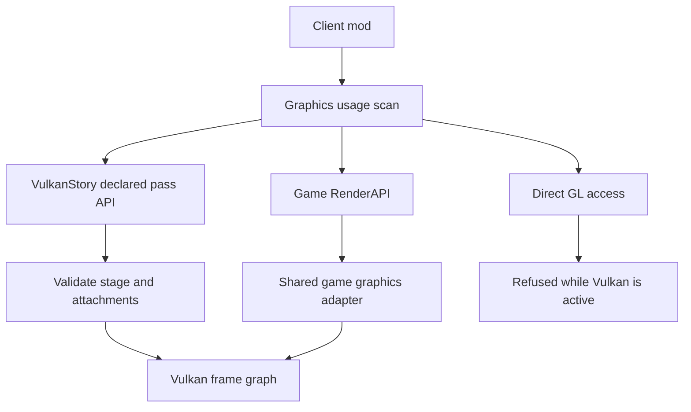

# Mod integration

## Choose a rendering interface

Mods using Vintage Story's ordinary `RenderAPI` reach the same graphics adapter
as the game. Game-facing texture/mesh IDs belong to a shared registry, so a mesh
uploaded through the API is not placed in a disconnected renderer.

Selected mod shader includes are preserved through asset resolution and the GLSL
rewriter. Owned passes resolve includes without initializing the game's shader
registry; ordinary registered stages keep the game's loading lifecycle. Changing
an include prevents use of the stock native shader
bundle; it does not by itself disable scene motion. Retained geometry stages must
still link with the required motion outputs before the renderer publishes them.

Reconstruction and frame-generation providers share a separate motion guide.
Depth-matching object vectors are retained; pixels without a matching writer use
depth/camera reprojection, with rotation-only reprojection for the sky. This gives
static custom geometry camera motion without replacing its shading. Independently
moving custom geometry still needs object/animation history: camera reprojection
does not supply that history or certify an absent object writer.

The animated-history integration remains in development. Programs using the
ordinary game pose/model producer will be able to use that history
independently of their pass name. Eligibility requires linked motion output and
compatible `Animation`/`AnimationPrev` column-major `mat4` arrays, plus the existing
previous-camera/model uniforms. Pose uploads must cover whole matrices at offset
zero and fit the declared capacity. Capture follows accepted model writes and a
successful upload to the active program's pose buffer. Drawing checks both bound
pose buffers, the current frame/view, and unchanged model/warp inputs. Shader
reload, relink, world changes and later buffer writes invalidate readiness.

Pose histories retain original array identity and separate programs/views. Reusing
one pose for different transforms within a frame declines its writer; mesh or draw
order is not substituted for object identity. This ABI check does not reconstruct
arbitrary procedural deformation or prove a shader's motion equations. Such draws
still require their real previous inputs through the motion-writer contract below.

Direct OpenGL calls are different. OpenTK GL calls, native GL imports and GL
proc-address loaders expect an OpenGL context and cannot operate on Vulkan
resources. When Vulkan routing is active, `ModGlUsage` examines enabled client
mod metadata before executing the code. Unsupported direct graphics access is
refused through the game's mod error path and reported in runtime status.
Passing this scan does not guarantee that a mod's higher-level behavior works.

While Vulkan owns the game API, legacy instance `Harmony.UnpatchAll()` calls
without an owner are scoped to that instance's ID. Explicit owner IDs keep their
normal behavior. World/mod disposal therefore preserves other owners' live hooks,
including the renderer's resource cleanup routes.



## Declared passes

The extension API lives in `VulkanStory.Game.ModRendering`. It lets a mod declare
which existing attachments its rendering reads and writes at a game render stage.
The adapter can then transition sampled images, open a compatible rendering scope
and restore state after the callback. It is not a shader-pack loader or a general
OpenGL translation layer.

Compile against the matching `VulkanStory.Game.dll` and official game API. Do not
bundle a second copy of the game integration assembly in your mod. It is supplied
by the VulkanStory early runtime. A hard assembly reference makes your mod depend
on that runtime being present; optional compatibility requires your own optional
integration/loading arrangement rather than assuming the namespace exists in
vanilla Vintage Story.

`VulkanStoryPassDecl` contains:

| Member | Meaning |
| --- | --- |
| `Name` | Unique pass name within the owning mod; re-registration replaces that name |
| `Slot` | Stage after whose ordinary registered renderers the callback runs |
| `Reads` | Existing named attachments sampled by the callback |
| `Writes` | Attachments written by the callback, on one target |
| `Draw` | Render-thread callback |
| `MotionWriter` | Optional motion declaration around the callback |

Registration validates and copies the declaration, including attachment arrays.
Editing your original object later does not update a registered pass. Register it
again when the intended declaration changes.

## Stages

| Stage | Contract |
| --- | --- |
| `Before`, `Opaque`, `OIT`, `AfterOIT` | Scene-stage slots; target rules still apply |
| `AfterPostProcessing`, `AfterFinalComposition` | Post-processing/composition stage slots; declaration must match its target |
| `AfterBlit`, `Ortho`, `Done` | Default window-color target slots |
| `ShadowFar`, `ShadowFarDone`, `ShadowNear`, `ShadowNearDone` | Enum entries exist, but declared writes at these stages are refused |

Values align with the game's `EnumRenderStage`. Declared passes run after the
ordinary renderers of their slot. Shadow maps can be sampled through read handles;
they are not writable mod targets.

## Attachments

| Handle | Use |
| --- | --- |
| `PrimaryColor`, `PrimaryGlow` | Lit scene and glow color slots |
| `PrimaryGBufferNormal`, `PrimaryGBufferPosition` | AO G-buffer slots, when allocated |
| `PrimaryDepth` | Scene depth shared by Primary and Transparent |
| `PrimaryMotion` | Temporal motion; sample through the handle, write through a motion declaration |
| `TransparentAccumulation`, `TransparentRevealage`, `TransparentGlow` | OIT color slots |
| `LiquidDepth` | Read-only liquid depth prepass |
| `ShadowFarDepth`, `ShadowNearDepth` | Read-only shadow maps |
| `GodRays`, `BloomLowRes`, `Luma`, `SsaoBlurred` | Read-only effect targets |
| `DefaultColor` | Write-only window color |

Attachment existence depends on current framebuffers and enabled effects. Missing
reads drop out of the resolved read set; a pass that requires a missing write is
skipped. This means your callback must not assume optional targets exist merely
because registration succeeded.

Contract validation refuses:

- Missing name or draw callback, unknown stage or attachment.
- A pass that writes nothing and declares no motion writer.
- Reads and writes of the same named attachment in one declaration.
- Writes spanning multiple color targets.
- Direct writes to `PrimaryMotion` or to read-only effect/shadow handles.
- Reads from `DefaultColor`.
- Default target writes outside `AfterBlit`, `Ortho` or `Done`.
- Scene target writes in those default-target stages.
- Primary depth attached to the default target.

## Registration example

This example shows registration and lifetime handling. `DrawOverlay` is where
your mod performs its actual rendering through the game API; the declaration
does not supply a shader or geometry for you.

```csharp
using Vintagestory.API.Client;
using Vintagestory.API.Common;
using VulkanStory.Game.ModRendering;

public sealed class ExampleOverlay : ModSystem
{
    private ICoreClientAPI? client;

    public override void StartClientSide(ICoreClientAPI api)
    {
        client = api;
        var pass = new VulkanStoryPassDecl
        {
            Name = "example-overlay",
            Slot = EnumVulkanStoryPass.Ortho,
            Writes = new[] { EnumVulkanStoryAttachment.DefaultColor },
            Draw = DrawOverlay
        };
        if (!api.RegisterVulkanStoryPass(this, pass, out string reason))
            api.Logger.Warning("Overlay registration refused: {0}", reason);
    }

    private void DrawOverlay(VulkanStoryPassDecl pass)
    {
        // Draw your own uploaded geometry through client.Render here.
    }

    public override void Dispose()
    {
        client?.UnregisterVulkanStoryPasses(this);
        client = null;
    }
}
```

Register and mutate the registry on the main/render thread. Ownership uses the
ModSystem's mod ID, with the assembly name as a fallback. The registry also removes
registrations on world leave. Dispose your own textures/meshes and event handlers;
registry removal does not own every resource your mod created.

## Motion writers

A moving object's shader needs its previous unjittered position; camera-only
reprojection cannot describe the object's own movement. Motion writers open a
controlled motion attachment window on Primary in `Opaque` or `AfterOIT`.

| Mode | Behavior |
| --- | --- |
| `WithColor` | Shade normal Primary color slots and write motion |
| `MotionOnly` | Write velocity for geometry already shaded |

Attach a `VulkanStoryMotionWriterDecl` to a pass, or register a standalone writer
with `RegisterVulkanStoryMotionWriter` and call `BeginMotionWriter` around your
draw. The standalone begin requires the exact registered writer instance. Only
call `EndMotionWriter` after begin returned true, and put it in `finally`.

The shader contract is:

```glsl
#if TAAMOTION > 0
layout(location = TAAMOTIONLOCATION) out vec4 motionOutput;
// In the draw's shader:
// motionOutput = vec4(previousPixel - currentPixel, reactive, writerDepth);
#endif
```

R/G are render-pixel movement from unjittered projections, B is reactive amount
in 0–1, and A matches the written window depth including offsets. If no previous
position exists, the shader still supplies reactivity and writes zero motion and
writer depth. Do not include raster jitter in object motion.

Motion windows use replacement blending. Begin can decline outside the temporal
window, on a wrong target/stage, for an unregistered writer, or when routing is
inactive. A pixel without a valid object writer uses camera reprojection. On
OpenGL, registration has no rendering effect and motion begin returns false.

## Failure handling and compatibility work

Contract errors are returned at registration. Callback exceptions are logged;
the adapter restores pass state before continuing its declared-pass processing.
That does not turn an invalid resource lifetime into a supported draw path.
Retain GPU-facing resources through their use and use the API's resource owners.

When adapting a direct-GL mod, identify the actual operations it requires: mesh
uploads, texture formats, shader changes, target access, readbacks and stage timing.
Move those operations to game RenderAPI or a declared pass, then verify temporal
motion and optional targets. A generic compatibility flag cannot establish this.

Authoritative declarations and validation are in
[VulkanStoryModPasses.cs](../src/VulkanStory.Game/ModRendering/VulkanStoryModPasses.cs).
Game-side execution is in
[GameGraphicsAdapter.ModPasses.cs](../src/VulkanStory.Game/GameGraphicsAdapter.ModPasses.cs).
