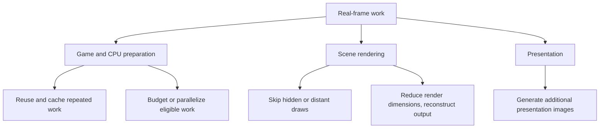
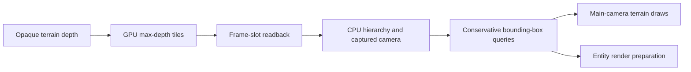
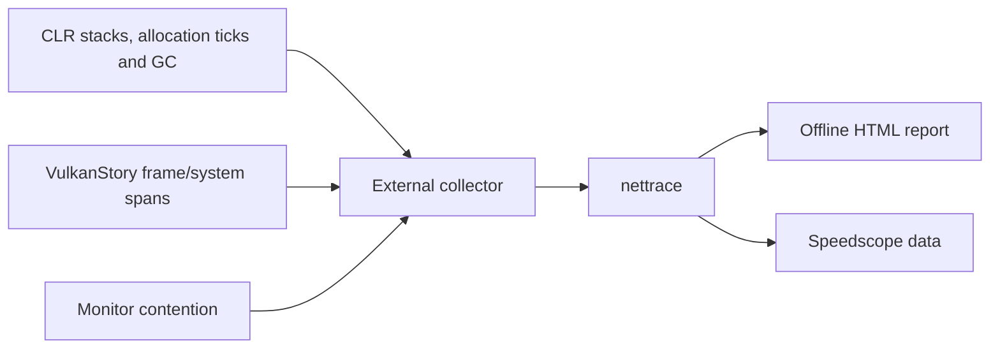

# Performance and profiling

## Where work is reduced

VulkanStory changes GPU submission and reconstruction, but also includes optional
game-side optimizations. They address different costs: less scene pixel work,
fewer unnecessary draws, reduced allocation, cached lookups and bounded scheduling.
A faster GPU pass will not automatically fix world-generation or CPU stalls.



This is a cost map, not measured speedup. Disabling a visual-budget feature can
restore detail while increasing work; disabling a cache should primarily change
how equivalent work is prepared.

## Installation and live controls

`PerformancePatchSet` installs optional features after renderer activation, before
world loading. Each feature has its own Harmony owner and signature/IL validation.
A refused feature reports its reason without making every other optional feature
unavailable. Runtime status and the Performance page show availability.

Installed hooks read the current settings snapshot. Turning a feature off selects
the ordinary path without repeatedly removing and reinstalling the patch.
Features that retain cached geometry or bookkeeping do so to support transitions.
Integrated-server changes affect the singleplayer server in this process; the
client package does not install these patches into a separate dedicated server.

The [settings reference](settings-reference.md) lists exact property names and
defaults. Performance boolean defaults are enabled; distances and particle budgets
have explicit numeric defaults.

## Visibility and shadows

| Feature | Work changed |
| --- | --- |
| `ShadowFarFoliage` | Skip foliage in the far shadow cascade |
| `EntityShadowCull` | Skip entity shadows beyond the configured horizontal distance |
| `DroppedItemCull` | Skip drawing drops beyond the configured horizontal distance |
| `ParticleDistanceGate` | Decline distant particle emitter spawns |
| `ChunkVisibilityWalk` | Use a precomputed shared ray tree for the game's visibility walk |
| `BfsChunkVisibility` | Use face connectivity for visibility traversal |
| `IndexedChunkVisibility` | Use loaded-chunk indices and precomputed neighbor edges for BFS |
| `TerrainOcclusionCull` | Skip main-camera terrain parts hidden behind opaque depth |
| `EntityOcclusionCull` | Skip hidden entity render preparation/draws |
| `OcclusionStorageReuse` | Reuse hierarchy storage with guarded publication/read access |
| `SimdFrustumTests` | Evaluate frustum planes using SIMD with original precision/thresholds |

Occlusion starts with GPU depth reduction after opaque terrain. The result is
8×8-pixel maximum-depth tiles copied to a frame-slot readback. When that slot is
available again, the CPU builds a max-depth hierarchy associated with the captured
view, projection and camera position. Queries test boxes against that recent view,
with expansion for camera movement. Unreliable cases remain visible: boxes outside
the captured view or crossing its near plane are not treated as occluded, and
players are not culled. Shadow visibility remains its own decision.



Visibility membership is copied under the chunk-map lock; traversal uses that
snapshot outside the lock. Published hierarchy storage cannot be reused while
a reader still uses it. Size/world changes discard or rebuild it.

## Streaming and world generation

| Feature | Work changed |
| --- | --- |
| `UploadQueueSortSkip` | Avoid sorting when ordering inputs have not changed |
| `MeshPartPool` | Reuse bounded mesh attribute storage rather than allocate every part |
| `ParallelChunkReads` | Read raw chunk column data in parallel in singleplayer; next-world setting |
| `WorldgenWorkers` | Choose off/auto/1/2/3 admission policy for the world's worker pool |
| `ParallelTerrainGeneration` | Allow idle workers to assist Terrain using independent workspaces |

World generation uses the game's passes, with ownership protection around shared
state: column footprint leases, Vegetation/sunlight synchronization, per-generator
locks and atomic entity IDs. Terrain assistance uses separate generator workspaces.
The pool is created for the world; live policy changes alter admission rather than
creating an unrelated new generation pipeline mid-world. Unsupported modded
worldgen hooks or worker failure can require the ordinary chunk-thread path.

## Entities, inventory and physics

| Feature | Work changed |
| --- | --- |
| `AnimationLinqFree` | Replace recurring allocation in collision-box animation checks |
| `FallingBlockMeshFix` | Correct falling-mesh buffer reuse and duplicate upload |
| `OutfitShapeCache` | Cache assembled trader/villager shapes and texture sets |
| `OutfitAnimatorCache` | Share immutable layout work while retaining independent mutable poses |
| `OutfitMetadataPreparation` | Prepare owned shape metadata off-thread; atlas insertion stays on the owner thread |
| `GuiItemRenderInfoReuse` | Reuse scratch render information within synchronous GUI drawing |
| `EntityRetessellationBudget` | Spread rebuilds over frames, with maximum eight-frame deferral |
| `PathfindingNodePool` | Reuse search nodes without reusing returned path ownership |
| `EntityLightBatch` | Batch visible entity light reads under the original chunk lock |
| `PhysicsCollectionReuse` | Reuse client lists after queued readers release them |
| `PhysicsActivationBatch` | Reserve capacity in batches while retaining same-tick entity activation |
| `EarlyItemMerge` | Merge eligible settled matching drops sooner in the integrated server |

These changes must not share mutable pose graphs between entities or invalidate
a path returned to an earlier caller. Deferred rebuild budgets retain overdue
work rather than starve it. Early merging respects player ownership and game
stack/collectible rules and bounds its work; it does not force garbage collection.

## Lighting, terrain detail and other caches

| Feature | Work changed |
| --- | --- |
| `WeatherWindSampleCache` | Cache wind lookup up to 50 ms; smoothing still updates every frame |
| `DynamicLightScanCache` | Bound membership scans to 100 ms with movement/population invalidation |
| `NearestLightSelection` | Select nearest lights without a LINQ sort allocation |
| `AnimatedBlockLod` | Stagger distant animation evaluation while accumulating elapsed animation time |
| `ChiselMeshLod` | Use a majority-material proxy beyond the configured distance; retain full geometry for transitions |
| `WorldMapPageCache` | Cache map pages on disk and render resident pages through a Vulkan array texture |
| `TranslationLookupCache` | Cache raw resolution with language/reload invalidation; format text live |
| `ShapeParseCache` | Reuse private static-shape templates with independent caller data |
| `AudioDecodeBufferReuse` | Pool PCM accumulation segments in the original Vorbis decoder |
| `CloudCoordinateReuse` | Reuse private cloud-update coordinate scratch |

`GodRaysSampleCap` and `HandheldShadowTier` are separate renderer policies for
reduced samples/shadow allocation. They are not the same as the game-side cache
switches above.

## Particle budgets

The spawn loop computes an effective quantity without mutating the shared particle
provider. Providers marked `IgnoreUserConfig` retain their original quantity.
Other configurable particles use density, per-call cap and available pool room:

```text
effective = requested × ParticleQuantityPercent / 100
effective = min(effective, ParticleSpawnLimit)       if limit > 0
effective = min(effective, max(0, poolLimit - alive)) if poolLimit > 0
```

Fractional quantity still uses the game's fractional sampling. Defaults are 50%,
256 particles per spawn and 8,192 per pool. The quantity can be restored to 100%
and limits disabled with zero, or `ParticleBudgets` switched off. This affects
visual density and is not just an allocation optimization. The inherited spawn
loop covers quads, cubes, asynchronous and secondary particles.

## Capture performance

In a loaded world:

```text
.vulkanstory profile start 30
.vulkanstory profile status
.vulkanstory profile stop
```

The collector runs outside the game process and attaches through EventPipe. Timing
hooks are dormant until the `VulkanStory-Performance` provider is enabled. Captures
last 1–300 seconds and are written under
`%LOCALAPPDATA%/VulkanStory/Performance/<capture>/`.

| Output | Use |
| --- | --- |
| `report.html` | Offline frame/system timing, stack and allocation inspection |
| `capture.nettrace` | Retained EventPipe events for later analysis |
| `capture.speedscope.json` | Flame graphs in other compatible viewers |



## Read the evidence

- Frame/system percentiles describe observed spans. Overlapping spans cannot be
  summed into an independent total without accounting for overlap.
- Sampled allocations estimate allocation activity; they are not an exact byte
  count for every call.
- Managed/external stack samples can include waits and native execution. A sample
  on a stack does not necessarily mean that thread was using CPU at that instant.
- Contention events identify waiting threads, lock identities, elapsed waits and
  owner IDs when available. A sampled stack alone does not identify the lock owner.
- These captures do not measure GPU execution time.
- Generated presentation count does not replace the real-frame interval series.

For comparison, keep the world, camera route, output dimensions, settings and
capture duration consistent. Separate first-use shader/provider initialization
from steady play, and change one relevant policy at a time. The isolated headless
harness includes capture/script work and a hidden-window throttle, so its frame
intervals are not an unrestricted desktop FPS benchmark.

See [headless harness](headless-harness.md) for isolated captures and
[development](development.md) for invoking the collector on an explicit process.
