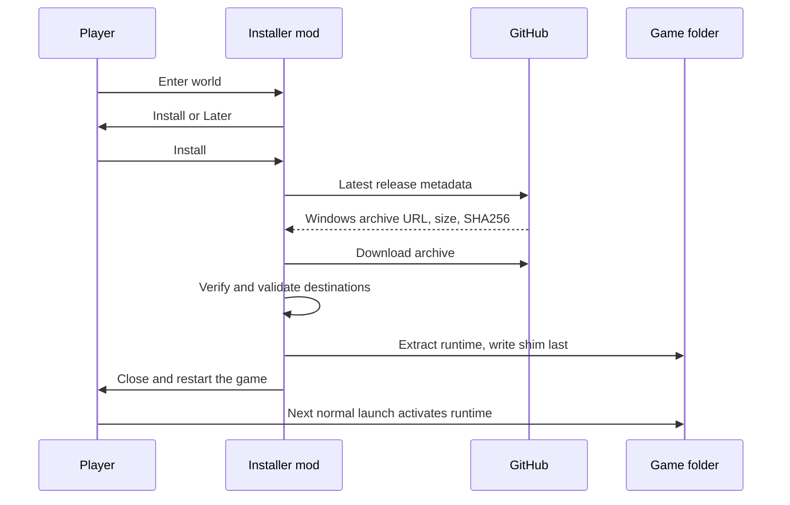

# Player guide

## What is installed

VulkanStory runs inside Vintage Story. On Windows, a `hostfxr.dll` shim beside
`Vintagestory.exe` activates it before the game creates its first window. The
runtime lives in `VulkanStory/`; two small game mods live in `Mods/`.
Installation adds these files alongside the official game files.

The current release targets Vintage Story 1.22.7 on Windows x64. Check the
[release page](https://github.com/KillerPixelCrew/VulkanStory/releases) for the
package you are installing. Multiplayer and compatibility with arbitrary mods
should not be assumed from singleplayer use.

## Install through the installer mod

1. Place `VulkanStory-Installer-0.1.5.zip` in the game's Mods folder, or your
   Vintage Story data directory's Mods folder. Leave the ZIP compressed.
2. Start the game and enter a world. The prompt runs after world loading finishes;
   it does not appear on the initial main menu.
3. Choose **Install**. The installer fetches GitHub's latest release metadata,
   downloads `VulkanStory-win-x64.zip`, checks its size and SHA256, and extracts
   the runtime into the folder containing the game executable.
4. Wait for the installed message, then close the game normally and start it again.
5. Remove the installer mod if you no longer need it.

Choose **Later** to keep playing without installing. Run `.vulkanstoryinstall`
in chat to reopen the dialog. Automatic prompting is limited by the mod instance;
an existing `VulkanStory/package.json` suppresses it.

The download requires internet access and write permission to the game directory.
The installer is for a fresh installation. It refuses to overwrite existing files,
including an existing `hostfxr.dll`. It does not update a running VulkanStory
installation or restart the game for you.



## Install manually

1. Close the game, dedicated server and crash reporter.
2. Download the Windows client ZIP from the release page.
3. Extract it into the folder containing `Vintagestory.exe`, keeping the archive's
   directory structure. Do not extract the full client package into `Mods`.
4. Start the game with your usual shortcut.

The client archive and installer mod ZIP are different packages. The former
contains the whole runtime; the latter contains only the download dialog.

## Options and commands

Open the game's regular **Options** menu for VulkanStory settings. In a loaded
world, `.vulkanstory settings` opens the settings dialog and
`.vulkanstory controller` opens controller settings.

| Command | Purpose |
| --- | --- |
| `.vulkanstory status` | Show runtime and provider state, including unavailable features |
| `.vulkanstory settings` | Open renderer settings |
| `.vulkanstory controller` | Open controller configuration |
| `.vulkanstory set Upscaler xess` | Select XeSS reconstruction |
| `.vulkanstory set UpscalerQuality quality` | Select reconstruction quality |
| `.vulkanstory set FrameGeneration xess` | Request XeSS frame generation |
| `.vulkanstory set Taa true` | Request native TAA when vendor reconstruction is not active |
| `.vulkanstory profile start 30` | Record a 30-second performance capture |
| `.vulkanstory profile stop` | End an active capture early |
| `.vulkanstory profile status` | Show capture state and output location |
| `.vulkanstoryinstall` | Open the separate installer mod's dialog |

Setting names are case-insensitive in the command parser. Boolean values are
`true` and `false`; numeric values use a decimal point. Provider identifiers are
`off`, `dlss`, `fsr3`, `fsr4` and `xess` for reconstruction, and `off`, `dlss`,
`fsr3` and `xess` for frame generation.

The settings dialog previews changes. **Save** persists them; **Cancel** restores
the earlier preview state. Renderer enablement, native shaders, Streamline and OpenXR
initialization need a restart. Parallel chunk reads apply on the next world load.
Provider and quality changes otherwise apply through the runtime's control queue.
They can rebuild resources and briefly stall; initializing FSR or XeSS can take
several seconds.

## Understand the graphics controls

**Render scale** changes the size of the scene's internal render targets. It is a
fraction of width and height, not pixel count. At 0.5 scale, the scene has one
quarter as many pixels. An active upscaler chooses its own input dimensions from
the requested quality mode.

**TAA** combines jittered samples over successive real frames to reduce aliasing.
Vendor reconstruction performs its own temporal reconstruction, so native TAA is
not stacked over an active vendor upscaler.

**Frame generation** adds interpolated presentation images between real rendered
frames. It does not accelerate world simulation or make input updates occur at
the generated display rate. The real/generated counter reports renderer/provider
presentation counters, not a measurement of the monitor's physical scanout.

**GTAO** estimates local shadowing from depth and normals. The game's AO quality
must also permit AO; choosing GTAO does not force AO on when the relevant game
post-processing path is disabled.

See the [settings reference](settings-reference.md) for defaults and limits, and
[rendering](rendering.md) for the image flow behind these controls.

The Performance page's **Resident terrain** (`ResidentTerrain`) and **Resident
entities** (`ResidentEntities`) switches are on by default and apply live. They
keep scene data in the renderer for GPU culling and indirect submission. Unsupported
or mod-patched content retains the existing per-draw compat path; turning either
switch off uses that path too. Translated shaders (`NativeShaders=false`) use the
compat lane. Resident terrain also falls back there when the device lacks
`shaderFloat64`.

**Compute particle geometry** and **Compute particle visual evolution** remain
on by default. **Compute particle fixed steps** (`GpuParticleSimulation`) is a
separate option and defaults off. Particle density and pool limits apply
independently of these switches.

## Controllers and multiplayer

SDL discovers controllers and loads the bundled mapping database. Per-controller
profiles control axes, deadzones, gestures, radial actions, glyphs and optional
feedback. A local mapping file can supply corrections for an unrecognized device.

The client runtime is enough for digital controller movement. Analog movement
negotiates with the `vulkanstoryinput` companion on the server. The client package
includes it for the integrated singleplayer server. A dedicated server can install
the separate companion ZIP into its Mods directory. If negotiation is absent,
movement falls back to digital controls.

For a mapping report, include controller name/model, connection type, whether
Steam Input is involved, which action is wrong, and the mapping/profile used.
See [window and controllers](window-and-input.md).

## Disable, update and remove

Disabling VulkanStory in the mod manager takes effect on the next game launch.
Alternatively, set `Enabled=0` under `[Bootstrap]` in `VulkanStory/loader.ini`.
That bypasses the managed startup hook.

Close the game before updating or removing the runtime. The packaged tools can
verify ownership, make backups and preserve modified files:

```powershell
# Use actual absolute paths for your installation, extracted package and backup.
./VulkanStory/tools/deploy-runtime.ps1 -GameDirectory <game> -PackageDirectory <package> -BackupDirectory <fresh-backup>
./VulkanStory/tools/remove-runtime.ps1 -GameDirectory <game> -BackupDirectory <fresh-backup>
```

The backup must be a fresh directory outside the game directory. Removal detaches
the activation shim first and retains modified files. Saves and player settings
are not runtime payload and are left in place. Removing only the ordinary
`vulkanstory` mod folder does not remove the early runtime.

## Troubleshooting

| Symptom | What to check |
| --- | --- |
| No installer prompt | Enter a world; check that the installer mod is enabled and that `VulkanStory/package.json` is absent; try `.vulkanstoryinstall` |
| Download fails | Internet access, GitHub rate limits, available disk space and the displayed error |
| Installer refuses a file | Existing deployment or another shim; the installer will not overwrite it |
| Installed, but renderer unchanged | Close and restart; check the game version, mod enabled state, `loader.ini` and startup log |
| A provider is unavailable | `.vulkanstory status`, runtime DLLs, device capability and driver; requested selection is not proof that it is active |
| Brief hang on provider change | Allow initialization to finish; include logs if it fails or does not recover |
| Frame generation pauses | Menu/loading/pause, incomplete camera or motion data, resize, swapchain readiness or provider restrictions |
| Mod refused while Vulkan is active | Direct OpenGL/OpenTK use can be incompatible; see [mod integration](mod-integration.md) |
| Controller movement is always full-speed | Check companion negotiation; digital fallback does not carry analog magnitude |

For renderer problems, provide game and VulkanStory versions, GPU/driver, selected
settings, reproduction steps, and these logs:

- `%LOCALAPPDATA%/VulkanStory/Logs/bootstrap-*.jsonl`
- `<Vintage Story data directory>/Logs/client-main.log`

For Windows crashes, attach the report ZIP from
`%LOCALAPPDATA%/VulkanStory/Crashes`. It includes crash details and matching logs;
review it for private information before sharing.

For stutter or CPU problems, include a performance capture. A screenshot alone
does not explain stalls; a CPU trace alone does not establish GPU rendering cost.
Current reported defects belong in the [roadmap](ROADMAP.md).
