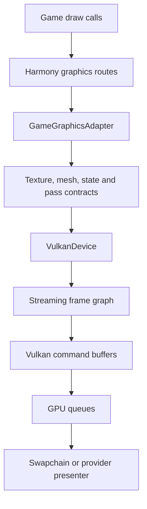
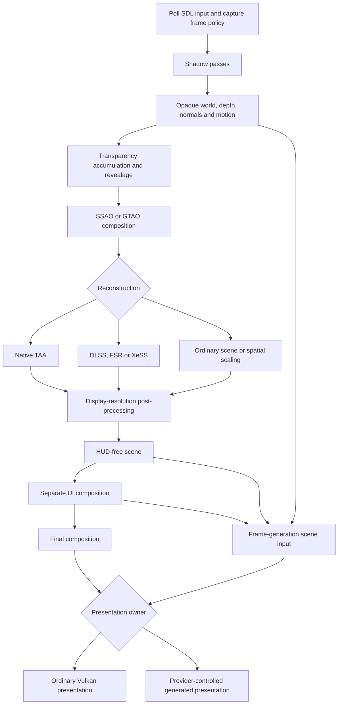
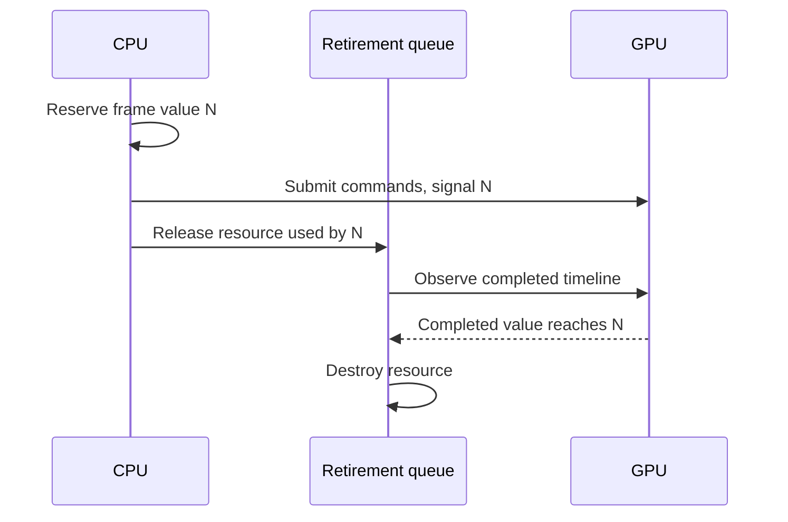
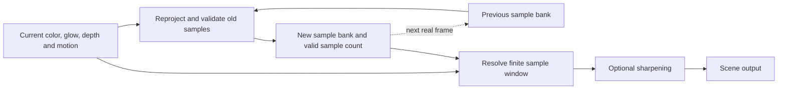
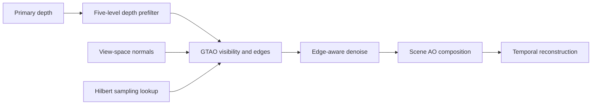
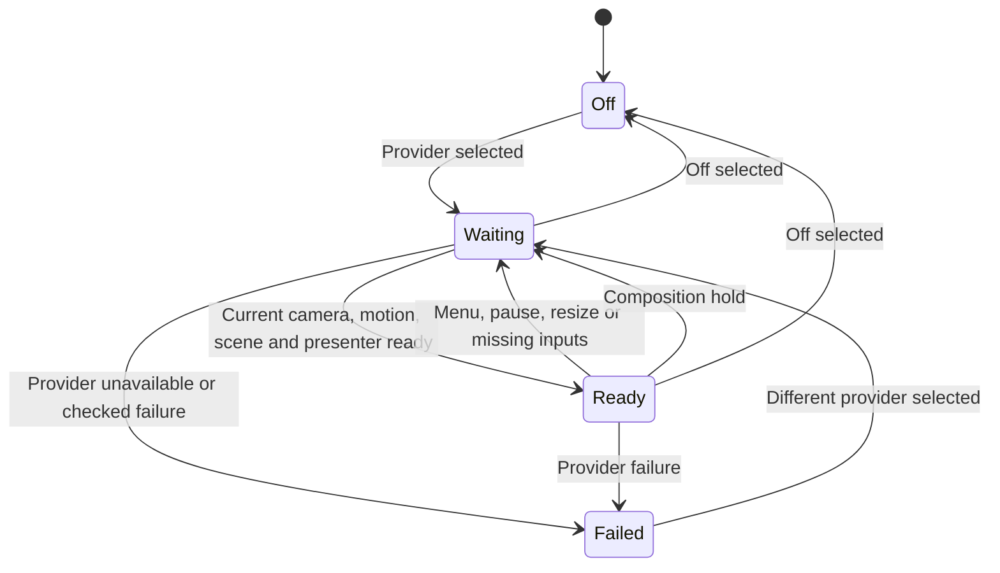
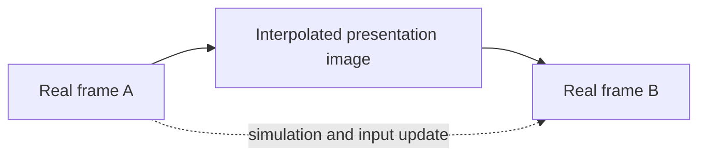

# Rendering

## The game-facing adapter

Vintage Story still decides what to draw: terrain, entities, particles, menus and
post-processing retain their game-side call order. Harmony routing redirects
graphics consumers into `GameGraphicsAdapter`. The adapter translates game
meshes, textures, programs, state and framebuffer operations into the renderer's
contracts. `VulkanDevice` owns the Vulkan objects and recording work.

The SDL window and device survive returning to the main menu. World references,
motion history and temporal history attach and detach when worlds change. This
separation avoids keeping a previous world's camera or entities alive through
process-level rendering objects.

## Frame order

The graph below is the logical image flow. Some effects have their own subpasses
and optional targets; it is not a promise that every box runs for every frame.

World composition readiness prevents the loading screen from disappearing before
the first completed world frame. Frame-generation preparation can inspect current
inputs during a composition hold, but generation remains paused while the held
loading image is presented.

## Streaming frame graph

The renderer records passes in the order the imperative game calls arrive.
`PassDeclaration` names the framebuffer, color slots, sampled texture IDs,
transient slots and sampling policy. This is a streaming graph, not a scheduler
that rearranges the game's passes.

`ResourceStateTracker` tracks image usage; `BarrierBatcher` emits required
transitions. A render-target image must be in the appropriate attachment layout
while written and a shader-readable layout while sampled. Feedback sampling can
require a copy or scope split instead of reading a live writable attachment.

`FramePlan` reuses information from prior matching frames to choose load behavior.
The graph retains two plans because temporal history banks alternate. A cached
plan is used only while the recorded prefix matches; changing pass order or
attachments declines that optimization. Store operations stay conservative
because later uses are not yet known when a streaming pass opens.

Clears issued outside an open pass are deferred. If the next use attaches the
image, the clear can become a render-pass load clear. If another use touches it
first, a standalone clear is recorded. Declared mod passes participate in this
same tracking; they do not bypass synchronization.

## Shaders and pipelines

There are two shader paths:

| Path | Input | Compilation |
| --- | --- | --- |
| Native replacement | Maintained GLSL under `shaders/native` | Compiled offline into SPIR-V and packaged in `shaders-vk.pak` |
| Game program | Game shader source and compatible mod overrides | Rewritten for Vulkan and compiled with shaderc at runtime |

The native pack contains an index, shader manifest and hashed blobs. A loose
`shaders-vk/` directory is a development fallback when the pack is absent.
`ShaderOverridePolicy` checks asset overrides before selecting a retained native
replacement. A changed asset is not silently treated as the original shader.

Programs, descriptor state, render-target formats and draw state determine
pipeline selection. Runtime shader binaries and the persistent Vulkan pipeline
cache live under `<game cache>/vulkanstory-vulkan`. Asynchronous pipeline creation
reduces synchronous compilation work in normal use; harness captures can request
synchronous creation for reproducible captures.

## Resource ownership and GPU completion

CPU disposal and GPU completion are separate events. A mesh or image that is no
longer referenced by game code may still be referenced by submitted commands.
VulkanStory defers destruction until those commands finish.

`FrameTimeline` owns graphics and transfer timeline semaphores. Values are reserved
before recording and marked submitted only after an accepted submission. Waits
are bounded by submitted values so the renderer does not wait for a value that
no queue will signal. Swapchain presentation uses binary semaphores separately.

VMA handles allocation and suballocation through `VulkanStoryVma`. The renderer
keeps purpose/type pool policy, staging behavior, provider headroom and heap
budget checks. Common frame targets, TAA sample banks and possible GTAO workspace
reserve capacity before competing geometry allocations grow. Framebuffer rebuilds
retire the old set before replacing its size-dependent targets.

These mechanisms describe ownership, not a claim that all memory defects are
resolved. Reported framebuffer allocation stalls and resource growth remain
tracked in the roadmap.

## Temporal inputs and coordinate conventions

`GameTemporalOwner` and `TemporalFrameState` capture camera and history state for
one real frame. `TemporalProviderFrame` carries jitter in render pixels, reset,
frame duration, camera planes and FOV, world camera position and the inverse view.
Providers receive this explicit snapshot rather than reading unrelated globals.

Motion is `previousPixel - currentPixel`, in render pixels, from unjittered
projections. World and first-person hand projections have distinct history.
Object, instance, held-item, particle and liquid producers supplement camera
reprojection for moving content. Sky motion has its own pass.

The motion-writer texture contains:

| Channel | Meaning |
| --- | --- |
| R/G | Previous minus current pixel position |
| B | Reactive amount in 0–1 |
| A | Writer depth, including the draw's depth offset |

Provider adapters convert motion layout, orientation and camera conventions where
needed. For example, Streamline input images are flipped into presentation
orientation; its motion and jitter signs are converted with the images. A provider
must not consume depth from one orientation and motion from another.

Frame identity, input extent and reset state must agree. Resize, world changes,
provider transitions and gaps in valid producers invalidate history. Missing
current inputs are not replaced with tags from a preceding world frame.

## Native TAA

The native TAA implementation uses a finite sample window. Two alternating banks
transport seven preceding scene/glow samples; the current frame supplies the
eighth sample. Resolved output history is not fed back as a cached input sample.
This keeps the history window distinct from a recursive blend of prior outputs.

Reprojection uses the inverse current jittered world view-projection and the
previous unjittered projection. Depth, motion and count data decide whether
history remains usable. First use, missing targets, a camera mismatch or an
invalid temporal window causes reset or refusal. `TaaReadiness` records why the
resolve did not run.

`TaaSharpness` controls the subsequent sharpen pass. `TaaMipBias` controls the
extra terrain texture bias. `TaaDebugView` selects diagnostic output. Native TAA
is selected only when an active vendor reconstruction path does not own temporal
reconstruction. The game FXAA path is suppressed when the effective temporal
pipeline owns that work.

## GTAO

GTAO estimates ambient visibility from scene depth and normals. It does not trace
world geometry or replace direct lights and shadow maps.

1. Prefilter the primary depth into five view-space depth levels.
2. Evaluate the visibility term and packed edge information.
3. Denoise with edge-aware passes.
4. Multiply visibility into the scene, with composition handling water, fog and
   transparency attenuation.

The visibility output is at render resolution. Sky and hand-view pixels have
visibility 1, so AO does not darken them. Low/medium/high/ultra select GTAO presets;
the game's AO and post-processing policy still controls whether the stage exists.
Allocation or program failure is reported instead of pretending GTAO ran.

## Upscaling backends

All reconstruction providers implement `IUpscalerBackend`: announce device
requirements, bring up against the selected device, plan input/output dimensions,
evaluate matching frame inputs, retire feature resources, and shut down.

| Setting | Backend | Main integration |
| --- | --- | --- |
| `dlss` | NVIDIA NGX | Vulkan resources through the NGX bridge |
| `fsr3` | FidelityFX FSR 3.1 | Vulkan reconstruction |
| `fsr4` | FidelityFX FSR 4 | DX12 runtime with Vulkan shared images/fences |
| `xess` | Intel XeSS | Vulkan reconstruction |

Providers prepare requirements before device creation. Later selection changes
replace plan-dependent resources and reset history; the window is not recreated
just to switch reconstruction providers. A missing runtime or unsupported feature
marks that provider unavailable. The requested setting remains distinct from the
effective plan, render scale and refusal reason.

The upscaler plan determines render width/height from output dimensions and
quality. Input color, depth, motion and optional transparency revealage belong
to the same real frame. The output is display-resolution color. Quality labels
are interpreted by the backend; do not assume every SDK uses identical ratios.

## Frame generation and presentation

Frame generation consumes a completed HUD-free scene, separate UI, depth, motion
and current camera data. `RuntimeFrameGeneration` selects the provider and checks
per-frame eligibility; the renderer and native bridge own the actual SDK dispatch
and presentation resources.

| Provider | Presentation path |
| --- | --- |
| DLSS-G | Streamline swapchain integration and tagged inputs |
| FSR 3 FG | FidelityFX proxy, or direct presentation when proxy queues are unavailable |
| XeSS-FG | DX12 presentation with Vulkan image/fence interop |

Only one presentation owner and pacing authority can control a frame. FSR 4
reconstruction and XeSS-FG use shared NT image handles and cross-API fences; both
sides must retain resources until the consumer has completed.

`PreparedThisFrame` means inputs passed preparation. It does not prove that the
SDK generated images or that the monitor displayed them. Configured output
multiplier is also separate from observed presentation counters. FSR 3's Vulkan
path supports 2×; DLSS-G and XeSS-FG consult their reported capabilities for
generated-image limits. The settings range of 2–6 is a request, not a guarantee.

This illustrates 2× presentation. It adds no intermediate simulation tick.
Generating more images therefore cannot repair an unstable real-frame cadence.

## Latency and frame pacing

The latency integrations include Streamline Reflex/PCL, AMD Anti-Lag and XeLL.
Input, simulation, rendering and presentation markers describe stages of the
same real frame. SDK sleep and ordinary limiting must respect the selected
presentation owner; independently sleeping several subsystems would distort
cadence and latency.

`LowLatencyMode` requests off/on/boost. The active provider decides what that
request means on the available runtime. PCL markers describe timing; they do not
by themselves imply interpolation is active. VSync and frame caps remain part
of captured frame policy and can affect whether a presenter is ready.

## Source map

| Topic | Source |
| --- | --- |
| Game frame/session | [GameRenderSession](../src/VulkanStory.Game/GameRenderSession.cs) and its partial files |
| Temporal state | [TemporalFrameState](../src/VulkanStory.Game/TemporalFrameState.cs), [TemporalProviderFrame](../src/VulkanStory.Contracts/TemporalProviderFrame.cs) |
| TAA | [TAA resolve](../src/VulkanStory.Game/GameGraphicsAdapter.Taa.cs), [sample banks](../src/VulkanStory.Game/GameGraphicsAdapter.TaaFir.cs) |
| AO | [GtaoRenderer](../src/VulkanStory.Render.Vulkan/AmbientOcclusion/GtaoRenderer.cs) |
| Pass tracking | [FrameGraph](../src/VulkanStory.Render.Vulkan/Graph/FrameGraph.cs) |
| Reconstruction contract | [IUpscalerBackend](../src/VulkanStory.Render.Vulkan/Upscale/IUpscalerBackend.cs) |
| Generation policy | [RuntimeFrameGeneration](../src/VulkanStory.Game/RuntimeFrameGeneration.cs) |
| GPU lifetime | [FrameTimeline](../src/VulkanStory.Render.Vulkan/Frame/FrameTimeline.cs) |

The [architecture](architecture.md) covers process startup and routing; the
[mod integration guide](mod-integration.md) covers third-party renderers.
