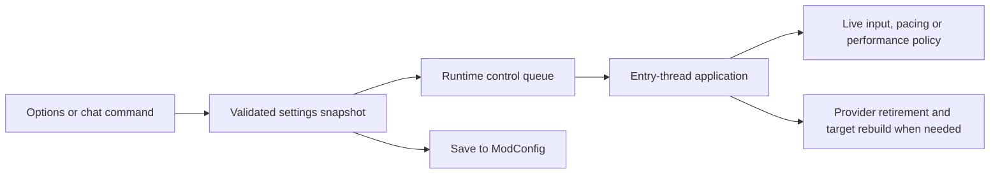

# Settings reference

Renderer settings are stored at `<data>/ModConfig/vulkanstory.json`.
Controller profiles are separate, in `vulkanstory-controllers.json`; their
processing is described in [window and controllers](window-and-input.md).

Defaults below are the `RendererSettings` source defaults for a missing property.
Existing player settings are retained. A default value does not establish that
the requested provider or feature is available on the selected device.

## Applying settings



The UI uses a draft with preview. Save persists the selected values; Cancel
restores the prior preview. Commands edit typed properties and call the runtime's
apply/persist callback. Numeric normalization rejects nonfinite input or clamps
values to supported ranges, depending on the entry point.

| Change | Takes effect |
| --- | --- |
| `Enabled`, `NativeShaders`, `Streamline`, `OpenXr` | Next game launch |
| `ParallelChunkReads` | Next world load |
| Reconstruction provider/quality, DLSS model preset, render scale, TAA/AO | Live; may rebuild targets and reset history |
| Generation provider | Live; resets previous presentation/provider state |
| Generation multiplier | Live, bounded by active SDK capability |
| Input, FPS counter and latency policy | Live |
| Performance switches and distances | Live policy reads; world-created pools remain owned by that world |
| `ResidentTerrain`, `ResidentEntities` | Live Performance-page switches; default on |
| `GpuChunkMeshing`, `GpuTerrainNoise`, `GpuParticleGeometry`, `GpuParticleVisualSimulation` | Live Performance-page switches; default on |
| `GpuParticleSimulation` | Live Performance-page switch; default off |
| `WorldgenWorkers` | Live admission policy using the existing world pool |

Changing restart settings writes the next-launch request. It does not recreate the
process runtime immediately. Changing a performance switch generally retains
installed hooks and changes the path they choose, allowing a return to the
ordinary behavior without repeatedly patching methods.

Resident submission uses native shaders and renderer-owned scene tables. Refused
pools/entities, foreign-patched policies and translated mode
(`NativeShaders=false`) use the compat lane: the existing per-draw path, including
stock vertex-shader skinning for entities. Resident terrain requires
`shaderFloat64` to reproduce stock visibility arithmetic; if that feature is
unavailable, it uses the compat lane automatically. A requested resident switch
does not mean every object was admitted.

## Choices

`OpenXr` enables the initial headset stereo path on the Device page. Connect the
headset to the selected PC OpenXR runtime before restarting the game. VR renders
two eye views with tracked head position/orientation and the runtime's eye FOVs.
Eye resolution comes from the runtime's recommendations and is independent of
desktop resizing or minimization. The desktop mirrors the right eye during world
rendering, with cursor coordinates mapped to the eye-sized game viewport.
Keyboard, mouse and ordinary controllers remain the input devices. Flat menu
screens use a head-locked OpenXR quad; world HUD/inventory panels and tracked
motion-controller input are later work. Both RGBA and BGRA sRGB runtimes are supported.

TAA, temporal upscaling, frame generation and vendor latency pacing are inactive
in this initial VR mode. Their saved desktop requests are retained. The OpenXR
runtime owns headset frame pacing; headset layers are submitted before desktop
acquisition, and a busy mirror can skip acquisition without delaying that layer.
Headset loss or missing tracking submits no
scene layer; runtime session exit returns to desktop presentation.

| Property | Values |
| --- | --- |
| `Upscaler` | `off`, `dlss`, `xess`, `fsr3`, `fsr4` |
| `UpscalerQuality` | `dlaa`, `quality`, `balanced`, `performance`, `ultraperformance` |
| XeSS quality additions | `ultraqualityplus`, `ultraquality` |
| `DlssPreset` | `default`, `j`, `k`, `l`, `m` |
| `FrameGeneration` | `off`, `dlss`, `xess`, `fsr3` |
| `LowLatencyMode` | `off`, `on`, `boost` |
| `AmbientOcclusion` | `auto`, `vanilla`, `gtao` |
| `AmbientOcclusionPreset` | `low`, `medium`, `high`, `ultra` |
| `WorldgenWorkers` | `auto`, `off`, `1`, `2`, `3` |

`dlaa` is displayed as Native AA. Quality choices are interpreted by the selected
backend. `fsr3` is the settings identifier for FSR 3.1 reconstruction; generation
has its own independent provider property.

Upscaler, quality, frame-generation provider and multiplier use dropdowns.
Unavailable choices remain visible in grey and cannot be selected. XeSS-only
quality choices are grey for other providers. Multiplier limits follow SDK
reports as they become available; FSR 3 FG supports 2x.

The DLSS preset selector appears when DLSS reconstruction is selected. Default
uses the runtime's model choice; J, K, L and M request the corresponding NGX model
hint. Changing it retires the old feature and applies the hint on the next DLSS
feature without restarting. Save retains it and Cancel restores the previous hint.

## Numeric ranges

| Property | Range | Default | Unit |
| --- | --- | --- | --- |
| `RenderScale` | 0.25–1 | 1 | Fraction of each output dimension |
| `TaaSharpness` | 0–1 | 0.2 | Sharpen strength |
| `TaaMipBias` | -2–0 | -0.5 | Extra terrain mip bias |
| `UpscalerLodBiasOffset` | 0–1 | 1 | Strength of provider LOD bias |
| `FrameGenerationMultiplier` | 2–6 | 2 | Requested total output images per real frame |
| `EntityShadowDistance` | 16–256 | 80 | Blocks, horizontal distance |
| `DroppedItemDistance` | 16–256 | 64 | Blocks, horizontal distance |
| `ChiselLodDistance` | 16–256 | 48 | Blocks |
| `ParticleQuantityPercent` | 0–100 | 50 | Requested spawn quantity percentage |
| `ParticleSpawnLimit` | 0–4096 | 256 | Particles per spawn call; 0 disables this limit |
| `ParticlePoolLimit` | 0–65536 | 8192 | Living particles per configurable pool; 0 disables this limit |
| `TaaDebugView` | Nonnegative integer | 0 | Diagnostic view index |

Generation multipliers remain requests: FSR 3's path is 2×; other providers query
their actual limits. An active reconstruction plan overrides ordinary render
scale. GTAO also depends on the game's AO quality and compatible scene shaders.

## Command examples

```text
.vulkanstory set Upscaler xess
.vulkanstory set UpscalerQuality quality
.vulkanstory set DlssPreset k
.vulkanstory set FrameGeneration xess
.vulkanstory set FrameGenerationMultiplier 2
.vulkanstory set AmbientOcclusion gtao
.vulkanstory set AmbientOcclusionPreset medium
.vulkanstory set ParticleQuantityPercent 75
.vulkanstory set TerrainOcclusionCull false
.vulkanstory status
```

Use the Options UI to inspect availability and save previews. A JSON property
alone records the request; `.vulkanstory status` describes the runtime result.
Do not edit the settings file concurrently with an open dialog that may save over
it. Editing while the game is closed avoids that conflict.

## Complete property inventory

The descriptions and defaults below follow the declarations in
[RendererSettings.cs](../src/VulkanStory.Game/RendererSettings.cs). Supported
choice and range definitions live in
[RendererChoices.cs](../src/Shared/RendererChoices.cs).

| Property | Type | Default | Behavior |
| --- | --- | --- | --- |
| `Enabled` | bool | `true` | Whether early startup should create the Vulkan/SDL session; disabling takes effect at the next launch. |
| `OpenXr` | bool | `false` | Enables the initial OpenXR headset stereo path on the next launch. |
| `RenderScale` | float | `1f` | Requested ordinary render fraction, normalized to 0.25 through 1; an active SR plan supplies its own scale. |
| `Taa` | bool | `false` | Requests native TAA when SR does not replace it and session readiness permits it. |
| `TaaSharpness` | float | `.2f` | Native TAA sharpening strength, normalized to zero through one. |
| `TaaMipBias` | float | `-.5f` | Additional native TAA terrain mip bias, normalized to -2 through zero. |
| `TaaDebugView` | int | `0` | Nonnegative native TAA diagnostic view index. |
| `TaaJitterDev` | bool | `false` | Development option requesting the temporal jitter window independently of the normal TAA/SR selection. |
| `Upscaler` | string | `"off"` | Requested SR provider identifier; effective availability is tracked separately by RendererSettingsState. |
| `UpscalerQuality` | string | `"quality"` | Requested SR quality identifier; allowed names are normalized against the requested provider. |
| `DlssPreset` | string | `"default"` | NGX reconstruction model hint, applied when the DLSS feature is created. |
| `UpscalerLodBiasOffset` | float | `1f` | Requested blend between provider-recommended and ordinary terrain mip bias, normalized to zero through one. |
| `FrameGeneration` | string | `"off"` | Requested FG provider identifier; per-frame eligibility and effective activation are tracked separately. |
| `FrameGenerationMultiplier` | int | `2` | Requested total output multiplier, normalized to 2 through 6; actual provider limits may be lower. |
| `ShowFpsCounter` | bool | `false` | Displays sampled real/generated presentation-counter rates in the game UI. |
| `LowLatencyMode` | string | `"on"` | Requested latency policy identifier: off, on or boost; the active provider owns pacing. |
| `AmbientOcclusion` | string | `"auto"` | Requested AO policy: auto, vanilla or gtao. |
| `AmbientOcclusionPreset` | string | `"medium"` | Requested GTAO quality preset: low, medium, high or ultra. |
| `AmbientOcclusionDebugView` | bool | `false` | Requests an AO diagnostic output instead of ordinary final shading where supported. |
| `GodRaysSampleCap` | bool | `false` | Enables the retained reduced god-rays sample policy. |
| `HandheldShadowTier` | bool | `false` | Requests the retained reduced shadow allocation/shader policy. |
| `NativeShaders` | bool | `true` | Enables compatible precompiled native shader paths; asset overrides may decline individual programs. |
| `Streamline` | bool | `true` | Requests Streamline initialization for supported NVIDIA latency/frame-generation features. |
| `ControllerEnabled` | bool | `true` | Enables controller polling and session game/UI bindings. |
| `TouchEnabled` | bool | `true` | Enables session touch-to-mouse handling. |
| `ShadowFarFoliage` | bool | `true` | Skips foliage (BlendNoCull terrain) in the far shadow cascade. |
| `EntityShadowCull` | bool | `true` | Skips entity shadows beyond EntityShadowDistance blocks. |
| `EntityShadowDistance` | int | `80` | Horizontal entity shadow distance in blocks. |
| `UploadQueueSortSkip` | bool | `true` | Skips re-sorting the chunk upload queue while nothing that orders it changed. |
| `AnimationLinqFree` | bool | `true` | Replaces the per-entity LINQ collision-box animation check with an allocation-free loop. |
| `FallingBlockMeshFix` | bool | `true` | Fixes the falling-block mesh buffer reuse and duplicate upload. |
| `MeshPartPool` | bool | `true` | Recycles the custom attribute parts of tessellated chunk meshes. |
| `ParticleDistanceGate` | bool | `true` | Skips particle spawns whose emitter lies beyond the view distance. |
| `ParticleBudgets` | bool | `true` | Applies live density, burst and resident limits to configurable client particles. |
| `ParticleQuantityPercent` | int | `50` | Percentage of the requested particle quantity, including fractional-count sampling. |
| `ParticleSpawnLimit` | int | `256` | Maximum particles per spawn call; zero disables this limit. |
| `ParticlePoolLimit` | int | `8192` | Maximum living configurable particles in each client pool; zero disables this limit. |
| `EarlyItemMerge` | bool | `true` | Merges settled matching dropped stacks sooner in the integrated server. |
| `DroppedItemCull` | bool | `true` | Skips drawing dropped items beyond DroppedItemDistance blocks. |
| `DroppedItemDistance` | int | `64` | Horizontal dropped-item draw distance in blocks. |
| `OutfitShapeCache` | bool | `true` | Caches assembled villager/trader outfit shapes and texture sets, and pre-inserts outfit textures gradually after world load. |
| `ChunkVisibilityWalk` | bool | `true` | Walks the occlusion culler's own rays from a precomputed shared tree instead of recomputing each ray. |
| `TerrainOcclusionCull` | bool | `true` | Leaves terrain chunk parts hidden behind opaque terrain (GPU depth pyramid of a recent frame) out of the main camera draws. |
| `ResidentTerrain` | bool | `true` | Persistent terrain part/pool tables, pre-graphics compute visibility and indirect pass submission for admitted native pools; otherwise compat draws. Applies live. |
| `ResidentEntities` | bool | `true` | Persistent entity/submesh rows, current/previous poses, pre-graphics compute culling and indirect submission; native vertex shaders retain skinning. Applies live. |
| `GpuChunkMeshing` | bool | `true` | Builds supported stock cube terrain faces in compute; custom tessellators and unsupported producers retain CPU meshing. Applies live. |
| `GpuTerrainNoise` | bool | `true` | Batches supported stock singleplayer terrain noise and density signs, retaining original CPU threshold/block decisions. Applies live. |
| `GpuParticleGeometry` | bool | `true` | Produces supported cube, quad and rain current/previous render geometry in compute; unsupported inputs keep the original shader path. Applies live. |
| `GpuParticleVisualSimulation` | bool | `true` | Computes supported stock size, opacity and colour evolution with CPU materialization for unsupported inputs and transitions. Applies live. |
| `GpuParticleSimulation` | bool | `false` | Batches supported fixed-step particle integration in Vulkan compute, retaining stock world-dependent handling; applies live. |
| `EntityOcclusionCull` | bool | `true` | Skips render preparation and draws of entities hidden behind opaque terrain (same occlusion depth). |
| `ParallelChunkReads` | bool | `true` | Reads a chunk column's raw chunk data in parallel in singleplayer; applies at the next world load. |
| `WorldgenWorkers` | string | `"auto"` | Live singleplayer worldgen worker policy: off, auto, 1, 2 or 3. |
| `GuiItemRenderInfoReuse` | bool | `true` | Reuses render-info scratch objects only inside synchronous GUI item rendering. |
| `WeatherWindSampleCache` | bool | `true` | Caches wind samples for at most 50 ms while smoothing continues every frame. |
| `BfsChunkVisibility` | bool | `true` | Uses a face-connectivity flood instead of the ray tree for chunk visibility. |
| `AnimatedBlockLod` | bool | `true` | Staggers distant animated-block evaluation while retaining accumulated animation time. |
| `DynamicLightScanCache` | bool | `true` | Bounds dynamic-light membership scans to 100 ms with movement and population invalidation. |
| `NearestLightSelection` | bool | `true` | Selects the nearest dynamic lights without allocating a LINQ sort. |
| `EntityRetessellationBudget` | bool | `true` | Spreads existing entity shape rebuilds across frames with an eight-frame maximum deferral. |
| `PathfindingNodePool` | bool | `true` | Reuses temporary pathfinding nodes while keeping returned paths independent of later searches. |
| `EntityLightBatch` | bool | `true` | Batches visible entity light reads by chunk under the game's original chunk lock. |
| `SimdFrustumTests` | bool | `true` | Evaluates frustum planes in SIMD vectors with the game's original precision and LOD thresholds. |
| `OutfitAnimatorCache` | bool | `true` | Caches outfit pose layouts with separate mutable pose graphs for each entity. |
| `ParallelTerrainGeneration` | bool | `true` | Allows idle worldgen workers to generate Terrain columns with independent generator workspaces. |
| `PhysicsCollectionReuse` | bool | `true` | Reuses physics client lists only when queued readers have released them. |
| `PhysicsActivationBatch` | bool | `true` | Reserves activation-list capacity in one batch; all entities still activate in the original tick. |
| `ChiselMeshLod` | bool | `true` | Uses a majority-material proxy for distant chisel geometry while retaining full geometry for live toggles. |
| `ChiselLodDistance` | int | `48` | Distance in blocks at which chisel chunk parts switch to the proxy. |
| `WorldMapPageCache` | bool | `true` | Caches world-map pages on disk and renders resident pages with a Vulkan array texture. |
| `OcclusionStorageReuse` | bool | `true` | Reuses CPU occlusion depth and hierarchy storage without changing visibility tests. |
| `TranslationLookupCache` | bool | `true` | Caches raw translation resolution with language reload invalidation; formatting remains live. |
| `AudioDecodeBufferReuse` | bool | `true` | Uses pooled PCM segments in the original Vorbis decoder. |
| `ShapeParseCache` | bool | `true` | Caches private static-shape templates for fruiting-bush tessellation, with independent caller data. |
| `OutfitMetadataPreparation` | bool | `true` | Prepares outfit shape metadata on owned background inputs; atlas insertion stays on the owner thread. |
| `IndexedChunkVisibility` | bool | `true` | Uses loaded-chunk indices and precomputed neighbor edges for flood-fill visibility. |
| `CloudCoordinateReuse` | bool | `true` | Reuses private tile-position scratch vectors in the stock cloud updater. |
