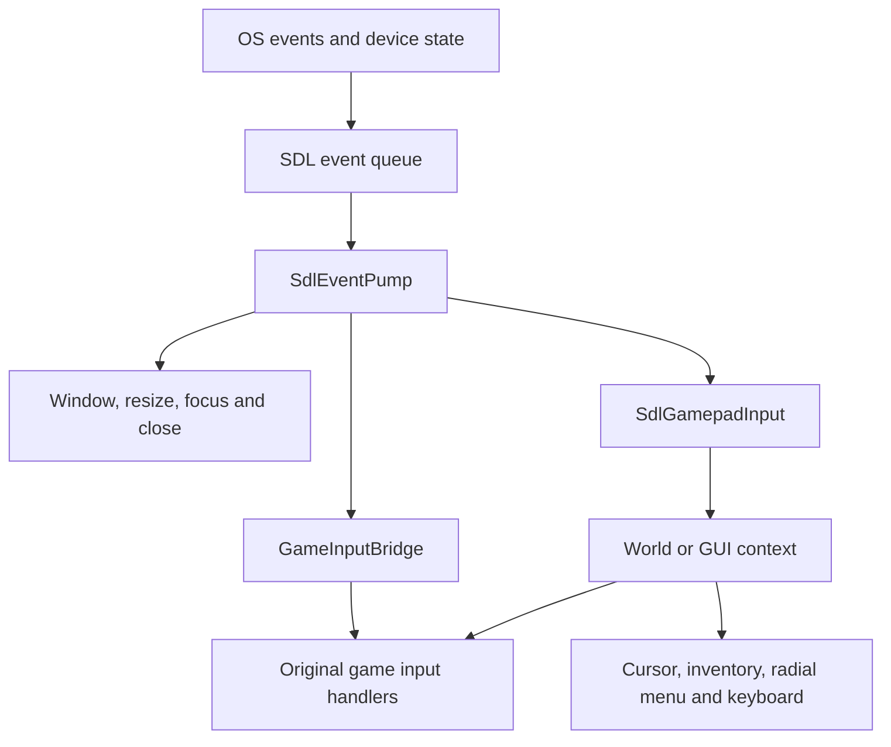
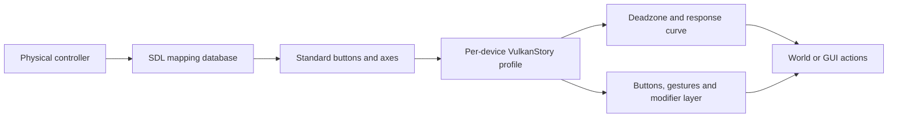
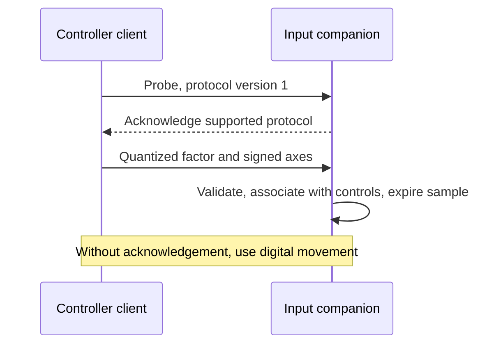

# Window and controllers

## SDL ownership

`SdlWindowHost` owns the native window, Vulkan surface requirements, sizing,
fullscreen state, focus, cursor capture, clipboard, text input and destruction.
`SdlEventPump` drains events on the session's owner thread once per frame.
The original game platform object remains present; adapters route its window
operations to SDL rather than substituting an SDL pointer for a GLFW window.



The event and game-facing layers are separate. `VulkanStory.Platform.Sdl` has no
dependency on game menus; controller semantics live in `VulkanStory.Game/Input`.

## Coordinates, mouse and text

SDL window coordinates and drawable pixels can differ on a high-DPI display.
`SdlWindowCoordinates` scales each axis using logical window size and drawable
size. The game UI consumes pixel coordinates; cursor warps and IME rectangles
are converted back to logical SDL coordinates.

For an axis with valid dimensions:

```text
pixel position = logical position × drawable extent / logical extent
```

Mouse capture uses SDL relative mode for world look. GUI navigation uses an
absolute cursor. Keyboard events, text commits and IME composition are distinct:
a key press is not used as a substitute for a Unicode text commit. The text bridge
locates focused editable fields and positions IME composition at their caret.

Focus loss and input-context changes release synthetic held keys/buttons and
clear state that would otherwise become stuck. Close requests flow through game
close handling; they do not bypass cancellation. Resize changes drawable extents
and may recreate the swapchain and frame targets. Minimized or parked presentation
cannot consume a stale drawable size as a normal rendering surface.

## Controller discovery and profiles

SDL gamepad discovery uses the bundled `gamecontrollerdb.txt`. A custom mapping
file at `<data>/ModConfig/gamecontrollerdb.txt` allows device mapping corrections.
The mapping database maps physical controls into SDL's standard axis/button
layout; a VulkanStory profile then maps that layout into game actions.

Profiles live in `<data>/ModConfig/vulkanstory-controllers.json`. The store accepts
schemas 1–3 and writes schema 3. A new device gets a validated named copy of the
default profile. Device identity uses available controller identity data; serial
data is hashed for the profile key. Profile migration updates old schema defaults
without treating every current player customization as an old default.



## Stick processing

Movement and look use radial deadzones. The direction is retained while magnitude
is remapped between the inner idle radius and outer saturation band.

```text
r = length(raw stick vector)
if r <= inner deadzone: output = zero
m = clamp((r - inner) / (1 - inner - outer), 0, 1)
output = direction(raw) × m^exponent
```

Inner deadzone is bounded to 0–0.8, outer deadzone to 0–0.2 and also bounded by
the inner value, and response exponent to 0.5–3. Nonfinite input becomes zero.
Movement defaults use a 0.16 inner deadzone and 0.5 exponent; look defaults use
0.16 and 1.5. Digital fallback uses separate press/release thresholds, 0.28/0.18,
to avoid repeatedly toggling movement at one threshold.

| Profile group | Controls |
| --- | --- |
| Movement | Axes, inversion, inner/outer deadzones, curve and digital thresholds |
| Look | Axes, inversion, curve and sensitivity |
| GUI | Cursor/scroll stick assignment and cursor sensitivity |
| Triggers | Axis assignment and activation threshold |
| Buttons | World and GUI action assignments |
| Gestures | Tap, long press, toggle behavior and modifier bindings |
| Radial menu | Eight action slots and hold/release confirmation |
| Gyro | Enablement, trigger condition, deadzone, sensitivity and inversion |
| Feedback | Ordinary and trigger rumble enablement, strength and duration |

Device support determines whether gyro and rumble can actually run. They are
optional profile requests, not mandatory capabilities of every controller.

## World, menu and inventory contexts

Gameplay maps buttons and triggers to the game's ordinary action handlers. When
a GUI opens, cursor and inventory semantics replace world actions. Switching
contexts clears relevant latches so a button held while opening an inventory does
not immediately trigger a different action behind it.

GUI input includes select, back, half-stack and quick-transfer behavior, tab/hotbar
navigation, and a cursor driven by the chosen stick. Inventory operations use
the foreground dialog's slot geometry and game semantics. The radial menu has
eight clockwise sectors from the top; moving the stick selects a sector after
the selection threshold is reached. Its confirmation behavior is configurable.

The on-screen keyboard targets editable text fields in both game dialogs and
menu screens. Glyphs come from the active mapping/profile and PromptFont assets,
so action hints follow the selected controller controls. Remapping should update
the action's hint rather than leave a fixed keyboard or controller label behind.

## Analog movement protocol

Analog magnitude needs server participation. The companion uses player-entity
packets; it does not require installing the Vulkan renderer on the server.



| Constant | Value |
| --- | --- |
| Movement packet | `0x4F505441` |
| Probe packet | `0x4F505442` |
| Acknowledgement packet | `0x4F505443` |
| Protocol version | 1 |
| Sample lifetime | 600 ms |

Magnitude is quantized to an unsigned byte (0–255); signed axes use a 127-step
signed-byte scale. Samples are bounded and expire. Client acknowledgement is
associated with the current world and player identity, so a response from an old
connection cannot activate analog control in a later world. Physical keyboard
movement takes precedence, and absent negotiation falls back to ordinary full-speed
digital movement.

The full Windows client package includes the companion for the integrated server.
A dedicated server uses the separate companion ZIP. Renderer and frame-generation
settings remain client-side; the companion is concerned with input only.

## Report a mapping issue

Include device model, USB/Bluetooth connection, game and VulkanStory versions,
Steam Input state, expected versus observed action, and whether the issue occurs
in the world, inventory or main menu. If the SDL mapping is wrong, provide the
custom mapping used; if the profile action is wrong, include the relevant profile
settings. Test axis and button assignment separately from deadzone tuning.

## Source map

| Topic | Source |
| --- | --- |
| SDL window and events | [Platform.Sdl](../src/VulkanStory.Platform.Sdl) |
| Native-to-game input | [GameInputBridge](../src/VulkanStory.Game/Input/GameInputBridge.cs) |
| Controller lifecycle | [SdlGamepadInput](../src/VulkanStory.Game/Input/SdlGamepadInput.cs) |
| Profile schema/defaults | [ControllerProfileStore](../src/VulkanStory.Game/Input/ControllerProfileStore.cs) |
| Radial curves | [ControllerStickProcessing](../src/VulkanStory.Game/Input/ControllerStickProcessing.cs) |
| Analog packets | [AnalogMovement](../src/VulkanStory.Input/AnalogMovement.cs) |
| Server companion | [AnalogInputCompanion](../src/VulkanStory.Input.Companion/AnalogInputCompanion.cs) |

## Controller profile reference

The table below lists the profile's source defaults. Button values are SDL
standard gamepad indices, not keyboard scancodes; axes are SDL normalized axis
indices. The Options UI is preferable to guessing numeric button values for
a physical device. Collections describe additional action overrides and radial
choices; these are validated and copied rather than shared between profiles.

Profile validation also bounds sensitivities to 20–3000, trigger activation to
0.05–0.95, gyro deadzone to 0–0.5, motor strengths to 0–1, and rumble duration
to 20–250 ms. Tap timing is 100–1000 ms; long-press timing must be at least 50 ms
above tap timing and at most 2000 ms. Persisted look exponent is 1–3, while the
shared processing routine supports 0.5–3 for movement curves. Invalid buttons
or axes revert to their field defaults.

| Property | Default | Behavior |
| --- | --- | --- |
| `Name` | `"Default"` | Device/profile display name shown by controller settings. |
| `MoveDeadzone` | `0.16f` | Movement stick's radial idle radius. |
| `MoveOuterDeadzone` | `0` | Movement stick's outer saturation band, coupled to the inner deadzone during validation. |
| `MoveCurveExponent` | `0.5f` | Exponent shaping movement magnitude after radial deadzone processing. |
| `MovePressThreshold` | `0.28f` | Digital movement activation threshold when negotiated analog walking is unavailable. |
| `MoveReleaseThreshold` | `0.18f` | Digital movement release threshold providing hysteresis below the press threshold. |
| `LookDeadzone` | `0.16f` | Look stick's radial idle radius. |
| `LookOuterDeadzone` | `0` | Look stick's outer saturation band, coupled to the inner deadzone during validation. |
| `MenuCursorUsesLeftStick` | `true` | Whether menu cursor movement uses the movement stick and scrolling uses the look stick. |
| `LookSensitivity` | `820f` | Scale for integrated synthetic mouse look before the retained 1.5 multiplier. |
| `CursorSensitivity` | `900f` | Menu cursor travel rate applied to the processed stick and frame duration. |
| `LookCurveExponent` | `1.5f` | Exponent shaping processed look-stick magnitude. |
| `TriggerThreshold` | `0.5f` | Normalized signed-axis threshold for primary and secondary trigger actions. |
| `MoveXAxis` | `0` | SDL axis used for horizontal movement. |
| `MoveYAxis` | `1` | SDL axis used for forward/back movement. |
| `LookXAxis` | `2` | SDL axis used for horizontal look. |
| `LookYAxis` | `3` | SDL axis used for vertical look. |
| `InvertMoveX` | `false` | Reverses the movement X axis. |
| `InvertMoveY` | `false` | Reverses the movement Y axis. |
| `InvertLookX` | `false` | Reverses synthetic horizontal stick look. |
| `ToggleSneak` | `true` | Enables the default sneak latch when no explicit sneak gesture mode overrides it. |
| `InvertLookY` | `false` | Reverses synthetic vertical stick look. |
| `GyroEnabled` | `false` | Requests gyro aiming when the selected SDL device provides the sensor. |
| `GyroRequireSecondaryTrigger` | `true` | Restricts gyro aiming to samples holding the effective secondary trigger. |
| `GyroSensitivity` | `500f` | Scale applied to integrated gyro angular rates for synthetic look. |
| `GyroDeadzone` | `0.02f` | Absolute gyro angular-rate threshold below which motion is ignored. |
| `InvertGyroX` | `false` | Reverses gyro yaw contribution to synthetic look. |
| `InvertGyroY` | `false` | Reverses gyro pitch contribution to synthetic look. |
| `RumbleEnabled` | `false` | Requests ordinary controller-motor feedback for actions and player damage. |
| `TriggerRumbleEnabled` | `false` | Requests physical trigger-motor feedback when the bound action uses a standard trigger axis. |
| `RumbleStrength` | `0.18f` | Normalized ordinary motor strength. |
| `TriggerRumbleStrength` | `0.14f` | Normalized trigger motor strength. |
| `RumbleDurationMs` | `70` | Action feedback pulse length in milliseconds; damage feedback uses its separate bounded duration. |
| `AcceptButton` | `0` | World jump/accept physical button. |
| `BackButton` | `1` | Legacy world/back button retained for schema migration. |
| `DropButton` | `12` | World drop-item physical button. |
| `InventoryButton` | `3` | World inventory-open physical button. |
| `CraftingButton` | `2` | World crafting shortcut button; routes to the game's inventory dialog. |
| `TakeHalfButton` | `2` | GUI half-stack/secondary-slot action button. |
| `QuickMoveButton` | `3` | GUI quick-transfer action button. |
| `GuiSelectButton` | `0` | GUI select/accept physical button. |
| `GuiBackButton` | `1` | GUI back/close physical button. |
| `RadialButton` | `8` | Physical button opening/confirming the configured radial wheel. |
| `RadialEnabled` | `true` | Whether gameplay may open the radial action wheel. |
| `ModifierEnabled` | `false` | Whether holding the modifier activates the shifted world-action layer. |
| `ModifierButton` | `9` | Physical button reserved for the modifier layer. |
| `TapThresholdMs` | `350` | Gesture tap-duration and second-press window in milliseconds. |
| `LongPressThresholdMs` | `700` | Gesture long-press duration in milliseconds, validated above the tap window. |
| `ActionModes` | `new(StringComparer.Ordinal)` | Explicit gesture overrides by world action or gui-prefixed action code. |
| `ModifierBindings` | `new(StringComparer.Ordinal)` | Explicit shifted world-action physical buttons; validation removes unsupported/reserved entries. |
| `RadialHoldToOpen` | `true` | Whether releasing the radial button confirms its selection rather than a later button press. |
| `RadialActions` | `ControllerRadialDialog.DefaultActions()` | Eight clockwise action tokens starting at the wheel's top sector. |
| `MenuButton` | `6` | Gameplay pause/menu physical button. |
| `SettingsButton` | `4` | Controller settings physical button. |
| `SneakButton` | `1` | Gameplay sneak/Shift physical button. |
| `SprintButton` | `7` | Gameplay sprint/Ctrl physical button. |
| `PreviousHotbarButton` | `9` | Previous hotbar slot or backward GUI tab physical button. |
| `NextHotbarButton` | `10` | Next hotbar slot or forward GUI tab physical button. |
| `PrimaryTriggerAxis` | `5` | SDL signed axis driving the primary mouse action. |
| `SecondaryTriggerAxis` | `4` | SDL signed axis driving the secondary mouse action. |
| `PrimaryTriggerNegative` | `false` | Whether negative primary-axis travel activates the action. |
| `SecondaryTriggerNegative` | `false` | Whether negative secondary-axis travel activates the action. |
